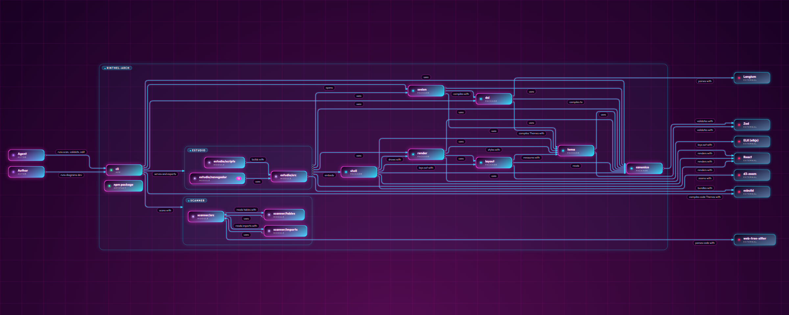

# rinthel-arch

A React + TypeScript system for writing and rendering large, detailed diagrams of any project. You describe your system once in text (`.dg`) and get several navigable Views, styled however you choose: the same diagram can look like sober cards, neon, a technical blueprint, sticky notes or a circuit board, by changing only the Theme.



## Highlights

- **Four diagram types.** `architecture`, `flow`, `sequence` (Interactions between Lifelines, with Fragments, Notes and Steps) and `er` (tables with keys and cardinality) share the same Model and the same Themes.
- **One Model, many Views.** Nodes, Edges and Attributes are written once; each View picks what to show (`include`, `exclude`, `depth`) and can link to another (drill-down) or reveal itself step by step.
- **Aesthetics are a Theme.** A Theme is text: a Palette, fonts and a stack of Layers per element, drawn from a closed catalog (shapes, fills, borders, shadows, glow, glass, strokes, markers, animations). There are example Themes (see the [gallery](docs/galeria.md)) and three built-in ones.
- **Live UI.** `dev` rebuilds on save and serves the [dev UI](docs/guia/ui-de-dev.md): a canvas (pan, zoom, Group collapse, node dragging that rewrites the `.dg`), a DSL editor, Issues with `fix`, a Theme gallery, the file History (undo and redo) and the Activity Log feed: what an agent does through the CLI.
- **Built for humans and agents.** `validate` returns structured issues with suggestions, `inspect` queries the Model and `skill` generates the agent skill for a Workspace.

## Getting started

Requires Node 20+ and pnpm. Not published on npm yet: use it from a clone.

```
git clone https://github.com/WilliamBarriga/Rinthel-arch.git
cd Rinthel-arch
pnpm install
pnpm build
node packages/cli/dist/bin.js dev --workspace examples/rinthel-arch
```

`dev` prints a URL (`http://127.0.0.1:4173/`). If the UI loads there, everything works; switch to the `abierto-<tema>` Views to see the example Themes. For your own diagram, point `--workspace` at a folder with your `.dg` files.

## Status and documentation

Version 0.x, not published on npm: the DSL and package contracts may change between versions. Supports four diagram types: `architecture`, `flow`, `sequence` and `er`.

The documentation is in Spanish for now. Start with the [Spanish README](README.md), the [tutorial](docs/guia/tutorial.md) and the [DSL reference](docs/guia/referencia-dsl.md); the code, CLI output and examples are usable regardless. Issues in English are welcome.

Licensed under [MIT](LICENSE).
