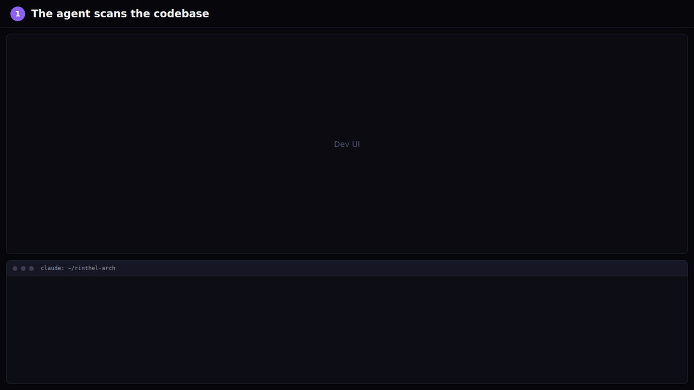
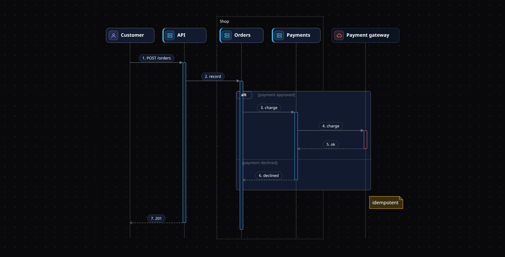
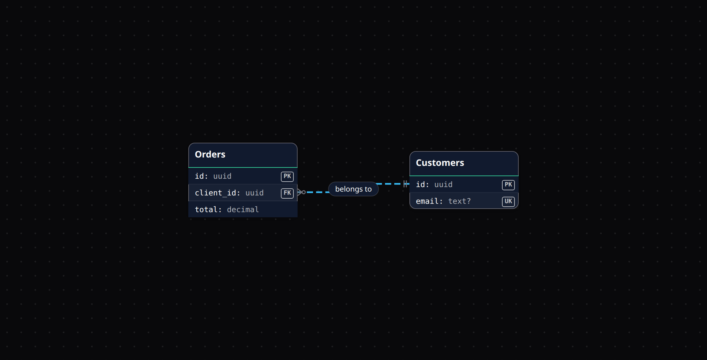
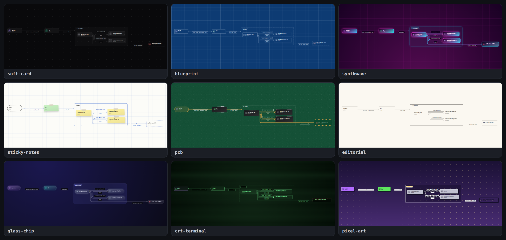

# rinthel-arch

**Diagramas de arquitectura de tu repo que tu agente de codigo puede leer, escribir y mantener al dia.**

Un modelo en texto, muchas vistas (arquitectura, flujo, secuencia, ER), con Temas y animacion paso a paso listas para charlas y video.

[](https://www.npmjs.com/package/rinthel-arch)
[](LICENSE)


[Read in English](README.md) | **[Demo en vivo](https://williambarriga.github.io/Rinthel-arch/)**



## Inicio rapido

**Con tu agente de codigo.** Instala las skills (un solo arbol `skills/` sirve a los cuatro agentes):

```
claude plugin install rinthel-arch --marketplace WilliamBarriga/Rinthel-arch
codex plugin marketplace add WilliamBarriga/Rinthel-arch
npx skills add WilliamBarriga/Rinthel-arch -a opencode -g
pi install npm:rinthel-arch
```

- **Claude Code** (2.1.292 o superior): dentro de una sesion, `/plugin install rinthel-arch --marketplace WilliamBarriga/Rinthel-arch` hace lo mismo.
- **Codex**: despues de agregar el marketplace, instala `rinthel-arch` desde el directorio de Plugins.

Luego pidele a tu agente, en tu propio repo:

> Diagram this repo.

El agente corre `scan`, escribe los archivos `.dg`, los valida y te da una URL local para abrir. Despues, "refresh the diagram" actualiza solo lo que cambio en el codigo, y "draw the system in this PRD" bosqueja un diseno que aun no existe. Las skills llaman al CLI con `npx -y -p rinthel-arch@<version> diagrams`, asi que no hay nada mas que instalar. El detalle por agente esta en la [guia de inicio rapido](docs/guia/quick-start.md).

**Sin agente.** Requiere Node 24 o superior:

```
npx rinthel-arch dev --workspace .
```

Abre `http://127.0.0.1:4173/` y escribe archivos `.dg` en esa carpeta (el [vistazo al DSL](#el-dsl-en-un-vistazo) de abajo es un primer archivo valido); la UI de dev redibuja en cada guardado. Instalado globalmente (`npm i -g rinthel-arch`), el CLI responde a `diagrams` y a `rinthel-arch`.

## Por que

- **Si trabajas con un agente de codigo:** lee el codigo, escribe el diagrama, lo valida y lo refresca cuando el codigo cambia, y tu revisas una imagen en lugar de un muro de texto.
- **Si presentas:** una sola fuente te da Vistas limpias para la documentacion y Vistas animadas y con Tema para charlas y video, sin redibujar a mano.
- **Si lees en espanol:** este README y todas las guias de usuario estan tambien en espanol.

## Que obtienes

- **Importar desde el codigo.** `scan` lee cualquier repo sin ejecutarlo (manifiestos, imports de TS/JS y Python, tablas de Prisma, SQL, Drizzle, Django y SQLAlchemy) y escribe un borrador de hechos que el agente convierte en Nodos, Aristas y Vistas. Correrlo de nuevo reporta lo que el diagrama ya no cubre y lo que cambio.
- **Blueprints.** Marca Nodos, Aristas, Atributos e Interacciones como `planned` para dibujar una propuesta junto a lo que existe; se dibujan atenuados y punteados, y `validate` senala los que el codigo ya construyo.
- **Cuatro Tipos de diagrama, un Modelo.** Las Vistas `architecture`, `flow`, `sequence` y `er` salen de los mismos Nodos y Aristas; las Vistas se enlazan entre si (drill-down) y se revelan paso a paso.
- **Temas.** Un Tema es texto: una Paleta, fuentes y Capas apiladas (formas, rellenos, vidrio, glow, trazos, animaciones). Catorce Temas de ejemplo y tres incorporados.
- **Una UI de dev en vivo.** `dev` sirve un lienzo, un editor del DSL, Issues con arreglo en un clic, una galeria de Temas, el Historial de deshacer y un feed de lo que hace tu agente.
- **Compartir en cualquier parte.** `export --workspace . --out diagram.html` escribe un solo archivo HTML autocontenido y de solo lectura que abre en cualquier navegador.
- **Un CLI hecho para agentes.** `validate --json` devuelve Issues estructurados con su arreglo, `inspect` consulta el Modelo con `archivo:linea` y `edit` aplica cambios estructurados.

| | |
| --- | --- |
| <br>`type sequence` | <br>`type er` |

## Temas

El mismo diagrama de este repo, cambiando solo el Tema:

[](docs/gallery.md)

Todos estan en la [galeria](docs/gallery.md); para hacer el tuyo, mira [Personalizar con Temas](docs/guia/themes.md).

## El DSL en un vistazo

```dg
specification {
  node actor   { icon user     color purple }
  node service { icon server   color blue }
  node store   { icon database color green }
}

model {
  actor customer "Customer"
  service api "API" "Entry point"
  service orders "Orders"
  store db "Database"

  customer -> api "HTTP"
  api -> orders
  orders -> db
}

view main {
  type architecture
  include **
}
```

El [tutorial](docs/guia/tutorial.md) lleva un diagrama como este a Grupos, Vistas enlazadas, secuencia y ER, y un Tema propio.

## Documentacion

| Guia | Para que |
| --- | --- |
| [Inicio rapido](docs/guia/quick-start.md) | Instalar en tu agente, correr el CLI y recorrer los ejemplos |
| [Tutorial](docs/guia/tutorial.md) | Un primer diagrama, de cero a personalizado |
| [CLI](docs/guia/cli.md) | Comandos, opciones, codigos de salida y salida `--json` |
| [UI de dev](docs/guia/dev-ui.md) | Paneles, editor, Historial, atajos y seguir a un agente |
| [Personalizar con Temas](docs/guia/themes.md) | Paleta, Capas, parches por Tipo y estado, Partes, movimiento |
| [Referencia del DSL](docs/guia/dsl-reference.md) | Modelo, Vistas, Pasos, Interacciones, ER y `planned` |
| [Catalogo de Temas](docs/theme-catalog.md) | Todas las Primitivas, Slots, Movimientos y Efectos con sus rangos (en ingles) |

Cada guia tiene su version en ingles en [docs/guide/](docs/guide/). Por dentro: el glosario esta en [CONTEXT.md](CONTEXT.md) y las decisiones de diseno en [docs/adr/](docs/adr/).

## Estado

Version 0.x: el DSL, los contratos JSON y los Temas pueden cambiar entre versiones menores. El trabajo pendiente vive en los [issues](https://github.com/WilliamBarriga/Rinthel-arch/issues).

## Contribuir

Los issues y pull requests son bienvenidos. Abre un issue antes de un cambio grande y lee [CONTRIBUTING.md](CONTRIBUTING.md), que tiene el mapa de paquetes y la compuerta de pruebas local. Para reportar una vulnerabilidad, mira [SECURITY.md](SECURITY.md).

## Licencia

[MIT](LICENSE). Las fuentes incluidas en los ejemplos traen sus propias licencias (OFL-1.1 y DejaVu) junto a los archivos.

El paquete `dsl` parte de la gramatica y el compilador de [LikeC4](https://github.com/likec4/likec4) (MIT); su aviso de copyright y licencia estan en [`packages/dsl/LICENSE-LIKEC4`](packages/dsl/LICENSE-LIKEC4).
