# rinthel-arch

Sistema (React + TypeScript) para escribir y renderizar diagramas grandes y detallados de cualquier proyecto. Describes tu sistema una vez en texto (`.dg`) y obtienes varias Vistas navegables, con la estetica que elijas: el mismo diagrama puede verse como tarjetas sobrias, neon, plano tecnico, post-its o placa de circuito, cambiando solo el Tema.

*In short: a text DSL for large architecture and flow diagrams, rendered with fully themeable, animatable styles. Documentation is in Spanish for now.*

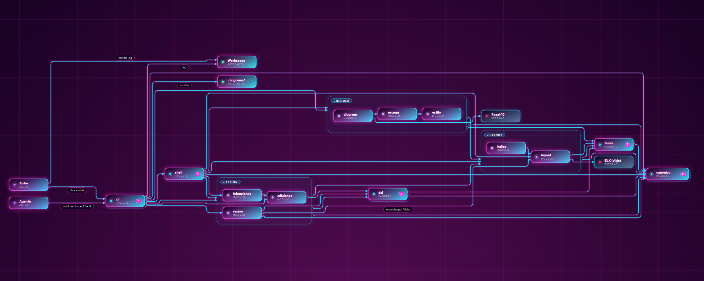

## Que ofrece

- **Un Modelo, muchas Vistas.** Los Nodos, Aristas y Atributos se escriben una vez; cada Vista elige que mostrar (`include`, `exclude`, `depth`) y puede enlazar a otra (drill-down) o revelarse paso a paso.
- **La estetica es un Tema.** Un Tema es texto: Paleta, fuentes y una pila de Capas por elemento, tomadas de un catalogo cerrado (formas, rellenos, bordes, sombras, glow, vidrio, trazos, marcadores, animaciones). Hay 14 Temas de ejemplo y tres incorporados.
- **Visor en vivo.** `dev` recompila al guardar; el visor tiene pan y zoom, colapso de Grupos y arrastre de Nodos que reescribe el `.dg`.
- **Pensado para humanos y agentes.** `validate` devuelve issues estructurados con sugerencias, `inspect` consulta el Modelo y `skill` explica el flujo a un agente.

## Galeria

El mismo mapa de este repo (`examples/rinthel-arch/`), cambiando solo el Tema. Cada imagen sale de una Vista `abierto-<tema>`.

| | | |
| --- | --- | --- |
| 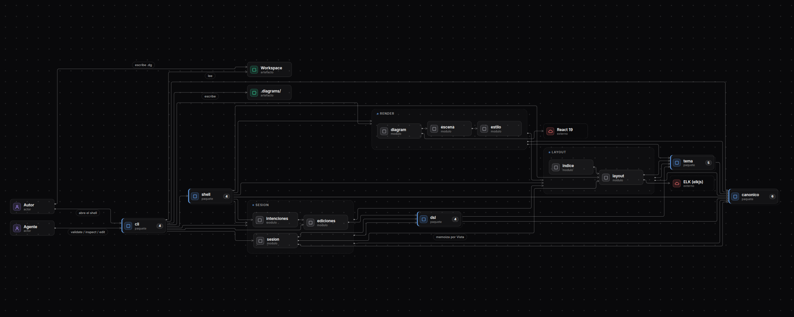<br>`soft-card` | 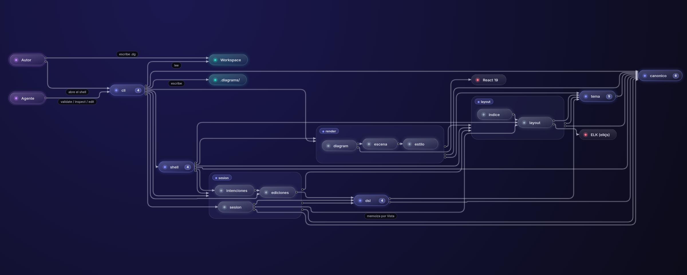<br>`glass-chip` | 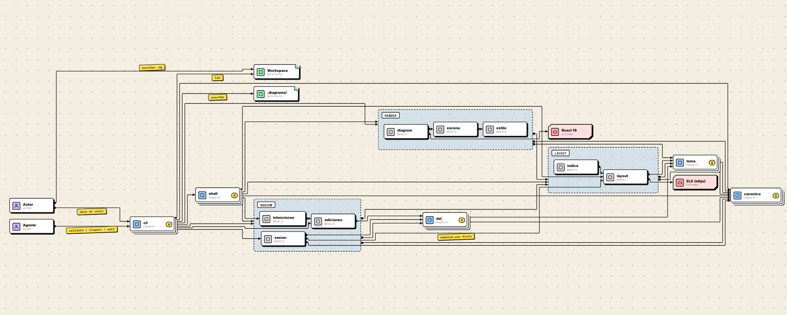<br>`neobrutalist` |
| 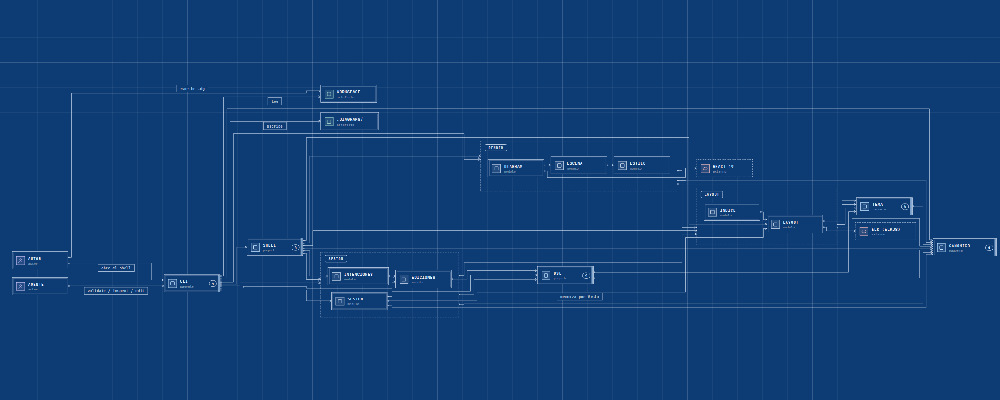<br>`blueprint` | 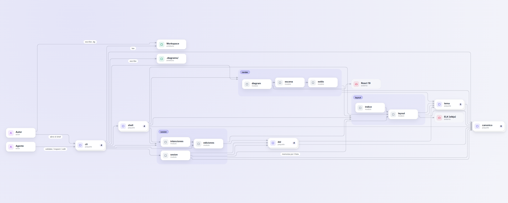<br>`claro-suave` | 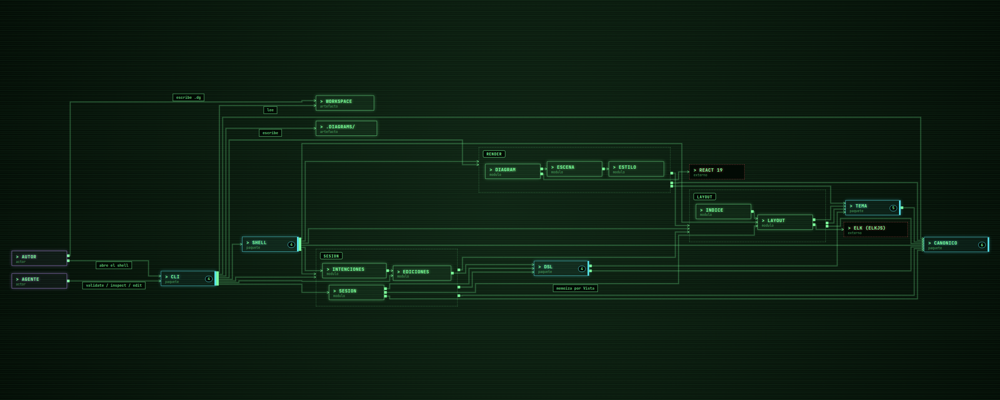<br>`crt-terminal` |
| <br>`synthwave` | 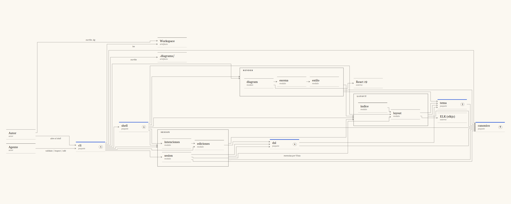<br>`editorial` | 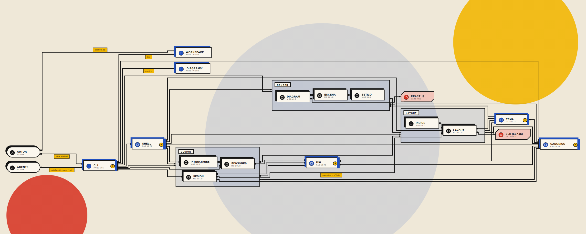<br>`bauhaus` |
| 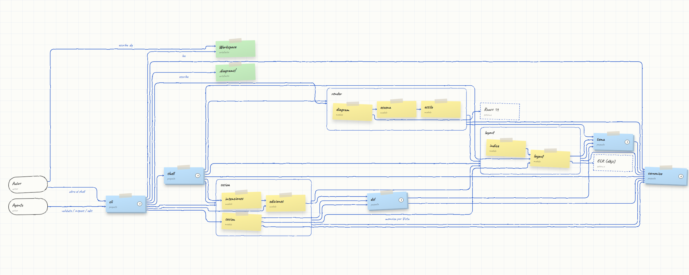<br>`sticky-notes` | 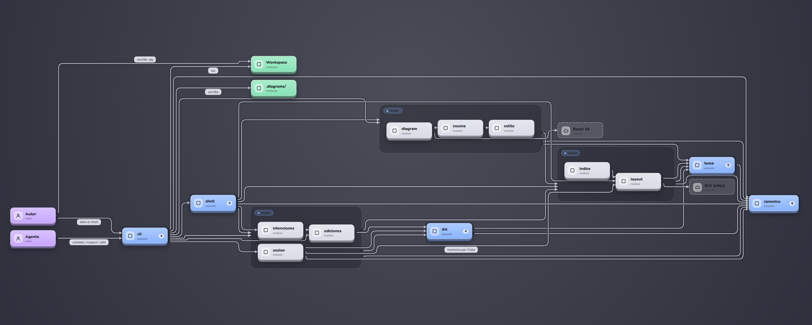<br>`keycaps` | 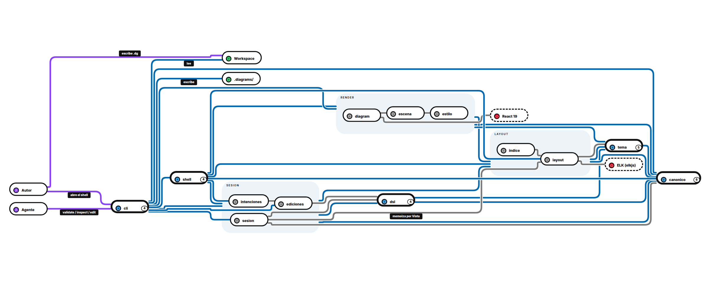<br>`metro-map` |
| 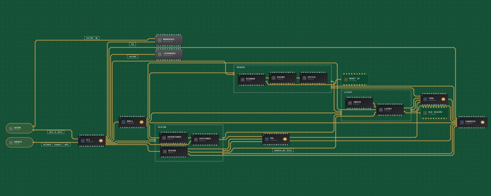<br>`pcb` | 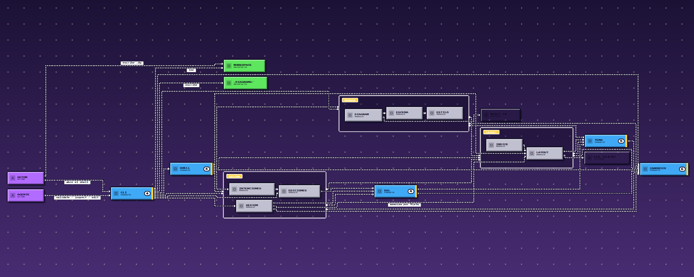<br>`pixel-art` | |

## Empezar

Requisitos: Node 20 o superior y pnpm. El paquete aun no esta publicado en npm: se usa clonando el repo.

```
git clone https://github.com/WilliamBarriga/Rinthel-arch.git
cd Rinthel-arch
pnpm install
pnpm build
node packages/cli/dist/bin.js dev --workspace examples/rinthel-arch
```

Abre la URL que imprime `dev` (`http://127.0.0.1:4173/`) y cambia a las Vistas `abierto-<tema>` para ver los 14 Temas.

## Documentacion

| Guia | Para que |
| --- | --- |
| [Inicio rapido](docs/guia/inicio-rapido.md) | Instalar, correr el CLI y recorrer los ejemplos |
| [Tutorial](docs/guia/tutorial.md) | Crear un diagrama pequeno y personalizarlo en cinco pasos |
| [Personalizar con Temas](docs/guia/personalizar-temas.md) | Paleta, Capas, parches por Tipo y estado, Partes, movimiento |
| [Referencia del DSL](docs/guia/referencia-dsl.md) | Sintaxis de Modelo, Vistas y Pasos |
| [Catalogo de Temas](docs/referencia-catalogo.md) | Todas las Primitivas, Slots, Movimientos y Efectos con sus rangos |

Para entender el sistema por dentro: el glosario esta en [CONTEXT.md](CONTEXT.md), las decisiones en [docs/adr/](docs/adr/) y las reglas de codigo en [docs/CODING.md](docs/CODING.md). Para contribuir, [CONTRIBUTING.md](CONTRIBUTING.md).

## Mapa del repo

| Ruta | Contenido |
| --- | --- |
| `packages/canonico` | Esquema de la Fuente canonica (Zod), validacion y resolucion de Vistas |
| `packages/tema` | Catalogo de Primitivas y Slots, Estilo resuelto y Metricas |
| `packages/dsl` | Gramatica (Langium) y compilador del texto `.dg` |
| `packages/layout` | Layout con ELK y Pins; geometria cacheada |
| `packages/sesion` | Tuberia compartida: compilar, validar y calcular geometria |
| `packages/render` | Dibujo puro en React (Nodos y Grupos en HTML/CSS, Aristas en SVG) |
| `packages/shell` | Visor interactivo: pan/zoom, colapso, arrastre |
| `packages/cli` | `validate`, `build`, `dev`, `inspect`, `edit`, `skill` |
| `examples/tutorial` | El tutorial, un Workspace por paso |
| `examples/rinthel-arch` | Este repo documentado con su propio DSL, con los 14 Temas |
| `examples/temas/galeria` | Un Modelo comun con los 14 Temas, y estados de cada Nodo |

## Estado

Primera entrega: Tipos de diagrama `architecture` y `flow`. Secuencia y ER vienen despues. El trabajo pendiente vive en los [issues](https://github.com/WilliamBarriga/Rinthel-arch/issues).

## Licencia

[MIT](LICENSE). Las fuentes incluidas en los ejemplos traen sus propias licencias (OFL-1.1 y DejaVu) junto a los archivos.

El paquete `dsl` parte de la gramatica y el compilador de [LikeC4](https://github.com/likec4/likec4) (MIT); su aviso de copyright y licencia estan en [`packages/dsl/LICENSE-LIKEC4`](packages/dsl/LICENSE-LIKEC4).
