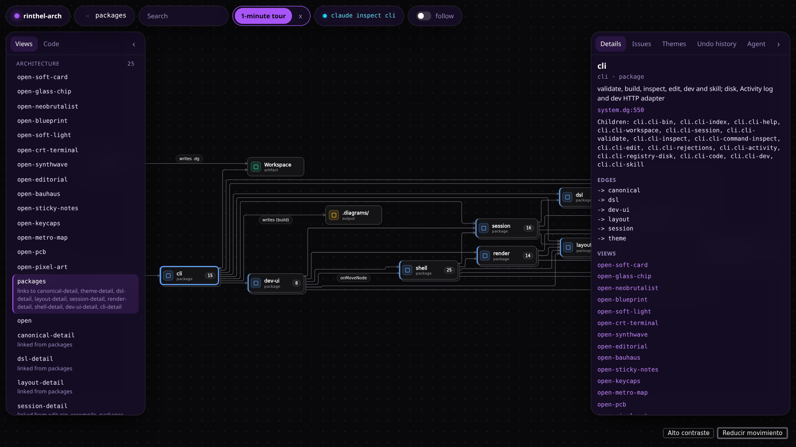
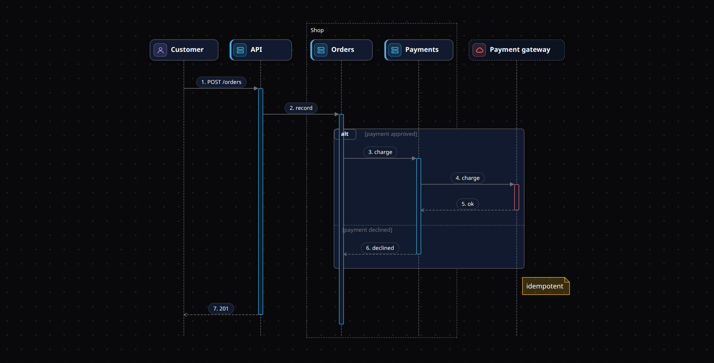
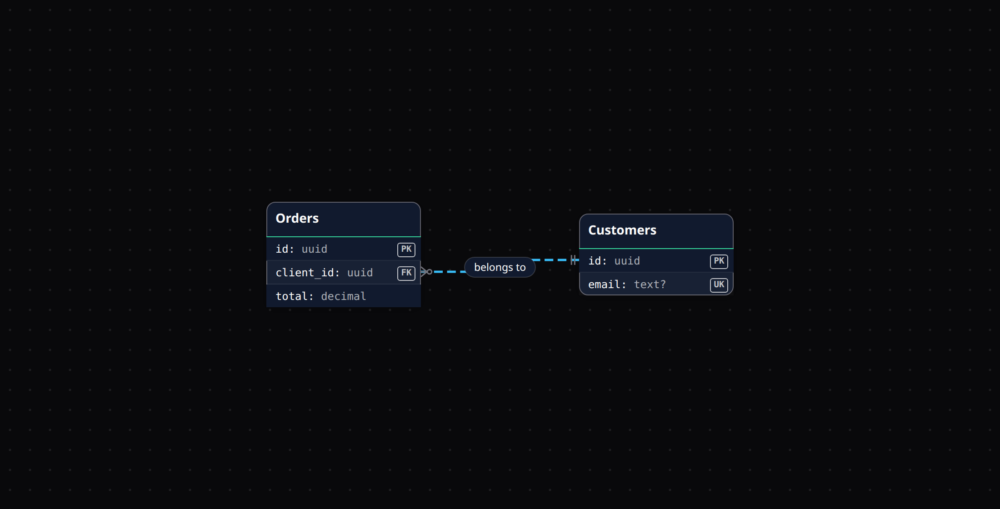
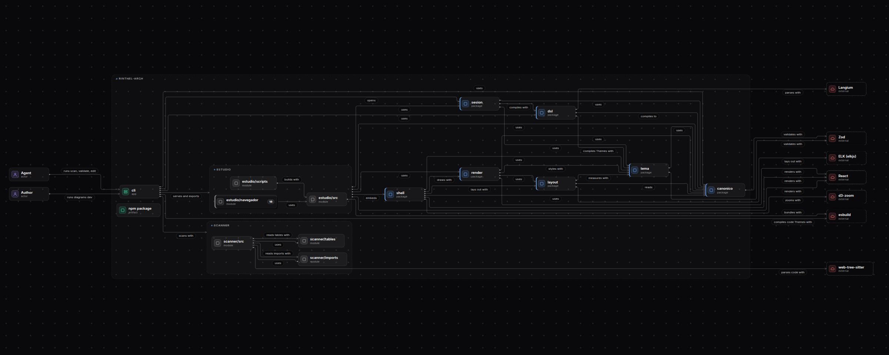
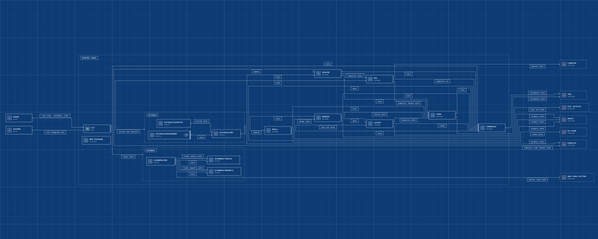
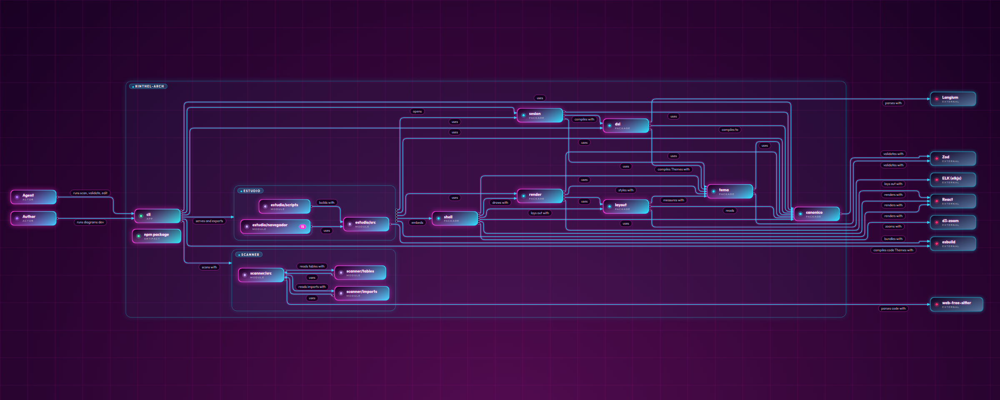
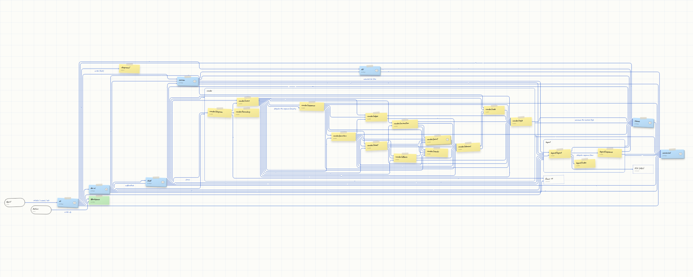
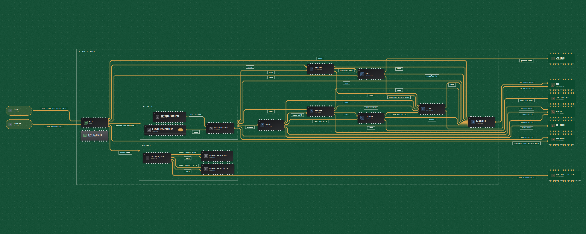
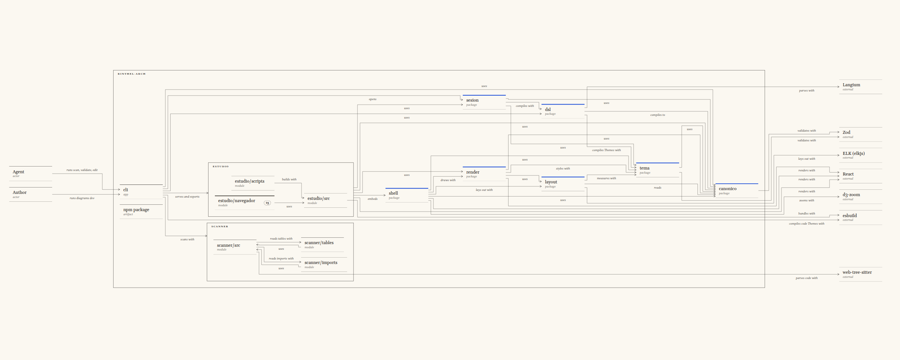

# rinthel-arch

**Architecture diagrams of your repo that your coding agent can read, write and keep up to date.**

One text model, many views (architecture, flow, sequence, ER), with themes and step-by-step animation ready for talks and video.

[](https://www.npmjs.com/package/rinthel-arch)
[](LICENSE)


[Leer en espanol](README.es.md) | **[Live demo](https://williambarriga.github.io/Rinthel-arch/)**

<!-- GIF slot (#250): an agent imports a codebase with `scan` and the diagram appears in the Dev UI with the changes highlighted. Replace this still image with the GIF. -->


## Quick start

**With your coding agent.** Install the skills (one `skills/` tree serves all four agents):

```
claude plugin install rinthel-arch --marketplace WilliamBarriga/Rinthel-arch
codex plugin marketplace add WilliamBarriga/Rinthel-arch
npx skills add WilliamBarriga/Rinthel-arch -a opencode -g
pi install npm:rinthel-arch
```

- **Claude Code** (2.1.292 or later): inside a session, `/plugin install rinthel-arch --marketplace WilliamBarriga/Rinthel-arch` does the same.
- **Codex**: after adding the marketplace, install `rinthel-arch` from the Plugins directory.

Then ask your agent, in your own repo:

> Diagram this repo.

The agent runs `scan`, writes the `.dg` files, validates them and gives you a local URL to open. Later, "refresh the diagram" updates only what changed in the code, and "draw the system in this PRD" sketches a design that does not exist yet. The skills call the CLI through `npx -y -p rinthel-arch@<version> diagrams`, so there is nothing else to install. Details per agent: [Quick start guide](docs/guide/quick-start.md).

**Without an agent.** Requires Node 24 or later:

```
npx rinthel-arch dev --workspace .
```

Open `http://127.0.0.1:4173/` and write `.dg` files in that folder (the [DSL glance](#the-dsl-at-a-glance) below is a valid first file); the Dev UI redraws on every save. Installed globally (`npm i -g rinthel-arch`), the CLI answers to both `diagrams` and `rinthel-arch`.

## Why

- **If you work with a coding agent:** it reads the code, writes the diagram, validates it and refreshes it when the code changes, and you review a picture instead of a wall of text.
- **If you present:** one source gives you clean views for docs and animated, themed ones for talks and video, without redrawing by hand.
- **If you read Spanish:** the README and every user guide are also in Spanish.

## What you get

- **Import from code.** `scan` reads any repo without running it (manifests, TS/JS and Python imports, Prisma, SQL, Drizzle, Django and SQLAlchemy tables) and writes a draft of facts that the agent turns into Nodes, Edges and Views. Running it again reports what the diagram no longer covers and what changed.
- **Blueprints.** Mark Nodes, Edges, Attributes and Interactions as `planned` to draw a proposal next to what exists; they are drawn faded and dashed, and `validate` points out the ones the code has since built.
- **Four diagram types, one Model.** `architecture`, `flow`, `sequence` and `er` Views are cut from the same Nodes and Edges; Views link to each other (drill-down) and reveal themselves step by step.
- **Themes.** A Theme is text: a Palette, fonts and stacked Layers (shapes, fills, glass, glow, strokes, animations). Fourteen example Themes plus three built-in.
- **A live Dev UI.** `dev` serves a canvas, a DSL editor, Issues with one-click fixes, a Theme gallery, an Undo history and a feed of what your agent is doing.
- **Share anywhere.** `export --workspace . --out diagram.html` writes one self-contained, read-only HTML file that opens in any browser.
- **A CLI built for agents.** `validate --json` returns structured Issues with fixes, `inspect` queries the Model with `file:line`, and `edit` applies structured changes.

| | |
| --- | --- |
| <br>`type sequence` | <br>`type er` |

## Themes

<!-- Themes mosaic slot (#250): replace with the mosaic of the same diagram in several Themes. -->
The same diagram of this repo, changing only the Theme:

| | | |
| --- | --- | --- |
| <br>`soft-card` | <br>`blueprint` | <br>`synthwave` |
| <br>`sticky-notes` | <br>`pcb` | <br>`editorial` |

All of them in the [gallery](docs/gallery.md); to make your own, see [Customizing with Themes](docs/guide/themes.md).

## The DSL at a glance

```dg
specification {
  node actor   { icon user     color purple }
  node service { icon server   color blue }
  node store   { icon database color green }
}

model {
  actor customer "Customer"
  service api "API" "Entry point"
  service orders "Orders"
  store db "Database"

  customer -> api "HTTP"
  api -> orders
  orders -> db
}

view main {
  type architecture
  include **
}
```

The [tutorial](docs/guide/tutorial.md) grows a diagram like this one into Groups, linked Views, sequence and ER, and a Theme of your own.

## Docs

| Guide | What for |
| --- | --- |
| [Quick start](docs/guide/quick-start.md) | Install in your agent, run the CLI, walk through the examples |
| [Tutorial](docs/guide/tutorial.md) | A first diagram, from zero to customized |
| [CLI](docs/guide/cli.md) | Commands, options, exit codes and `--json` output |
| [Dev UI](docs/guide/dev-ui.md) | Panels, editor, Undo history, shortcuts and following an agent |
| [Customizing with Themes](docs/guide/themes.md) | Palette, Layers, per-type and per-state patches, Parts, motion |
| [DSL reference](docs/guide/dsl-reference.md) | Model, Views, Steps, Interactions, ER and `planned` |
| [Theme catalog](docs/theme-catalog.md) | Every Primitive, Slot, Motion and Effect with its ranges |

Every guide has a Spanish version in [docs/guia/](docs/guia/). Under the hood: the glossary is [CONTEXT.md](CONTEXT.md) and the design decisions are in [docs/adr/](docs/adr/).

## Status

Version 0.x: the DSL, the JSON contracts and the Themes may change between minor versions. Planned work lives in the [issues](https://github.com/WilliamBarriga/Rinthel-arch/issues).

## Contributing

Issues and pull requests are welcome. Open an issue before a large change and read [CONTRIBUTING.md](CONTRIBUTING.md), which has the package map and the local test gate. To report a vulnerability, see [SECURITY.md](SECURITY.md).

## License

[MIT](LICENSE). The fonts bundled with the examples carry their own licenses (OFL-1.1 and DejaVu) next to the files.

The `dsl` package starts from the grammar and compiler of [LikeC4](https://github.com/likec4/likec4) (MIT); its copyright and license notice are in [`packages/dsl/LICENSE-LIKEC4`](packages/dsl/LICENSE-LIKEC4).
