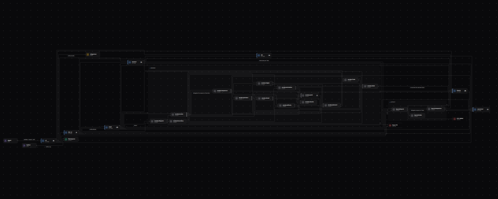
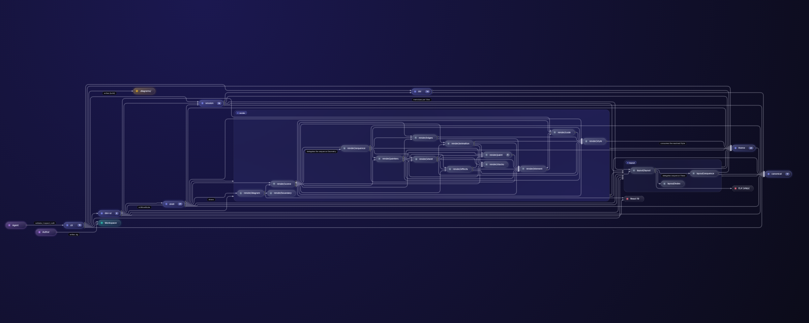
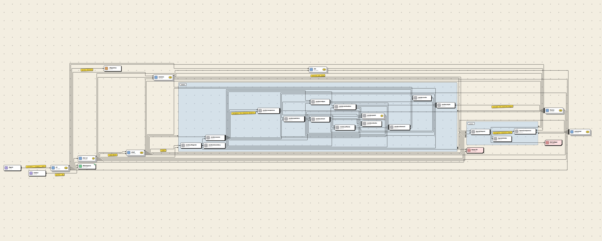
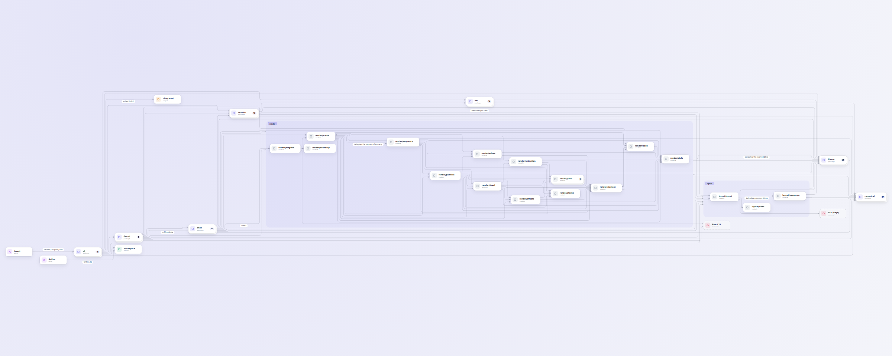
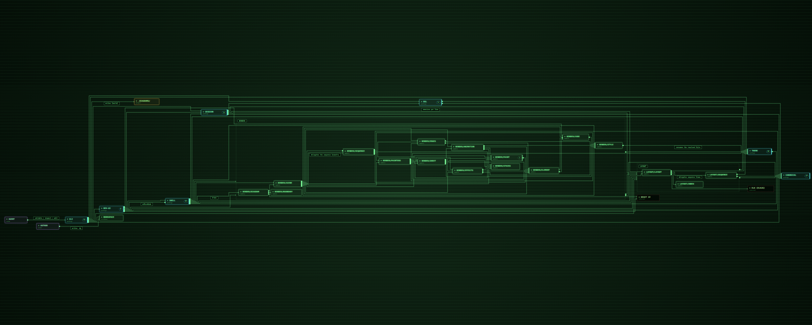
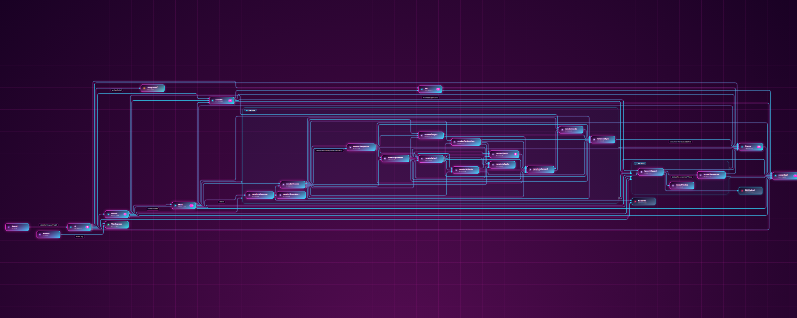
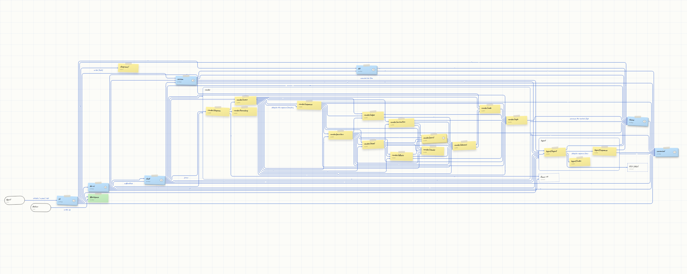
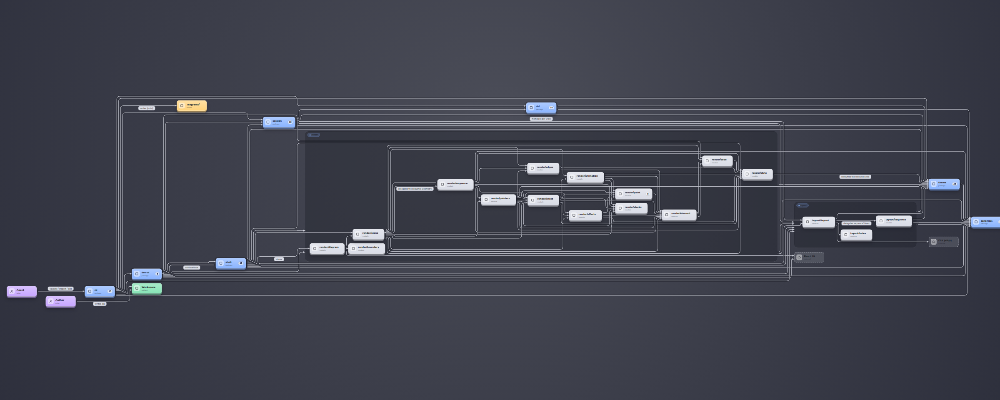
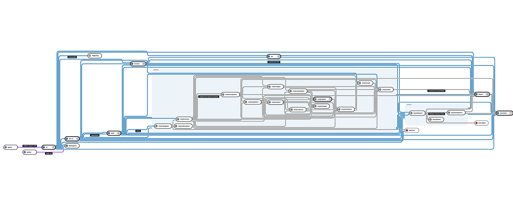

# Theme gallery

The same map of this repo (`examples/rinthel-arch/`), changing only the Theme. Each image comes from an `open-<theme>` View. To see them live: `dg dev --workspace examples/rinthel-arch` (see the [Quick start](guide/quick-start.md)).

| | | |
| --- | --- | --- |
|  `soft-card` |  `glass-chip` |  `neobrutalist` |
|  `blueprint` |  `soft-light` |  `crt-terminal` |
|  `synthwave` |  `editorial` |  `bauhaus` |
|  `sticky-notes` |  `keycaps` |  `metro-map` |
|  `pcb` |  `pixel-art` | |

To make your own, see [Customizing with Themes](guide/themes.md). Spanish: [Spanish guides](guia/themes.md).
