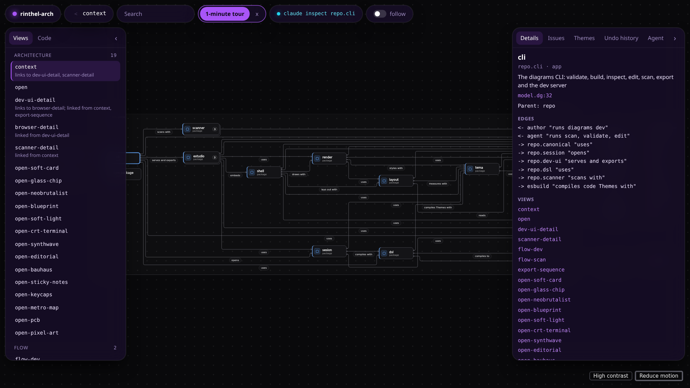
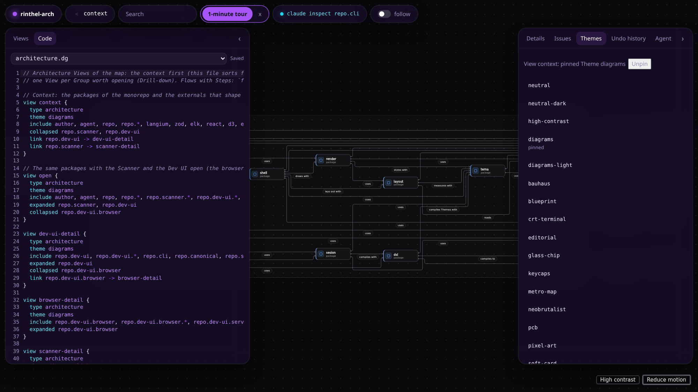
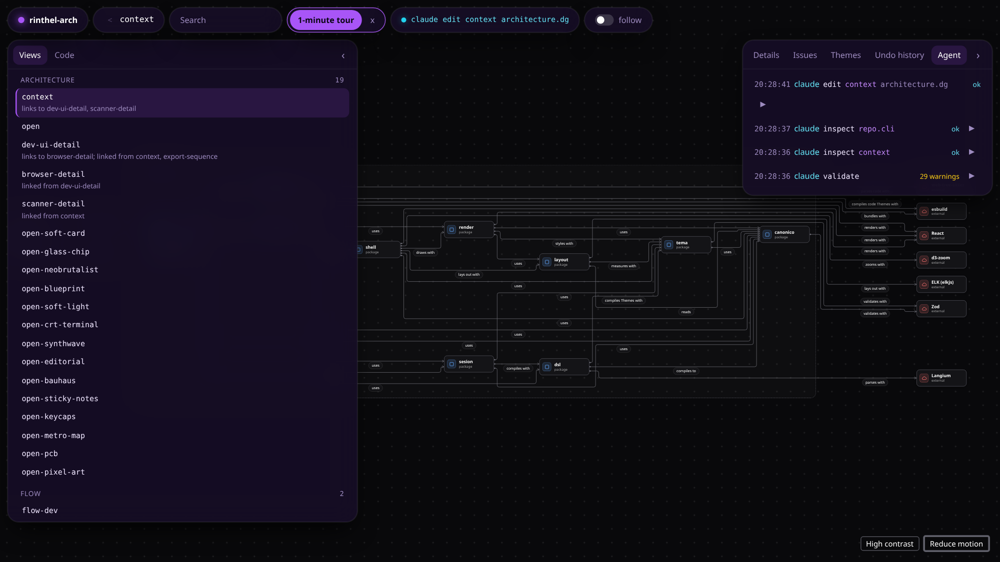
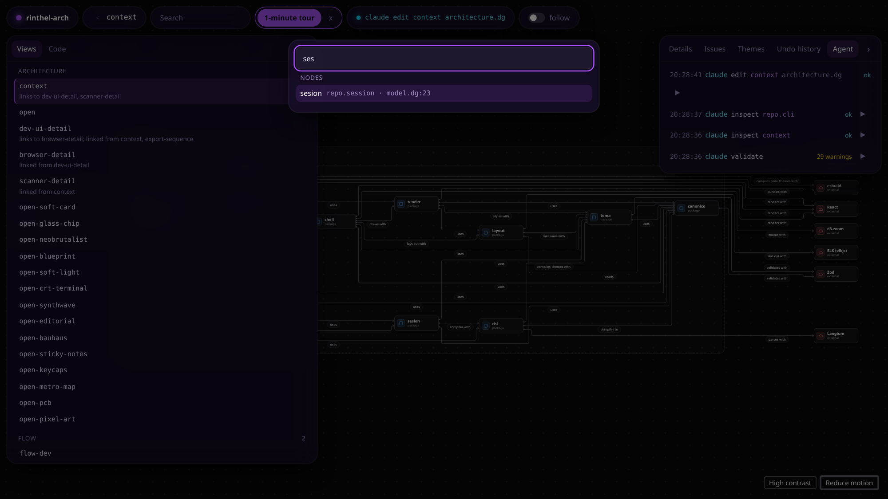

[Read in English](../guide/dev-ui.md)

# UI de dev

`dg dev --workspace <ruta>` abre en `http://127.0.0.1:4173/` una UI para mirar, editar y seguir un Workspace mientras un agente (o tu editor) lo cambia. Arranque y opciones del comando: [CLI, `dev`](cli.md#dev-visor-en-vivo).



El lienzo ocupa toda la pagina. Arriba va la barra (Vista actual con su ruta, Buscar, ultima linea del agente y "seguir"); a los lados, dos paneles flotantes. Cada panel se oculta con su boton o con Ctrl/Cmd+B (izquierdo) y Ctrl/Cmd+J (derecho); oculto, deja una pestana en el borde que lo vuelve a mostrar. Se redimensiona arrastrando su borde o su esquina (las asas de ancho y alto tambien responden a las flechas; doble clic en la de alto vuelve al alto del contenido). La Vista activa queda en la URL como `#view=<id>`, asi que se puede compartir o volver con Atras. Sobre el lienzo quedan los controles de Pasos (si la Vista los tiene), los botones "High contrast" (dibuja con el Tema `high-contrast` sin escribir nada) y "Reduce motion", y la leyenda cuando hay Tipos que solo se distinguen por color.

## Panel izquierdo

- **Views**: el indice agrupado por Tipo de diagrama, con las Vistas que enlazan o son enlazadas. Clic o flechas (Inicio y Fin van a la primera y la ultima) cambian de Vista. Un punto marca las Vistas que cambiaron por fuera y aun no visitaste.
- **Code**: editor del DSL; se abre tambien con doble clic en un Nodo (en su bloque) y abre a la vez Issues en la isla derecha. Guarda solo (unos 400 ms despues de dejar de teclear, al perder el foco o con Ctrl/Cmd+S), aunque el texto no compile: el lienzo conserva el ultimo dibujo bueno y los arrastres se deshabilitan con el motivo a la vista. Issues en linea con su `fix`, completado de palabras clave e ids, F12 a la definicion; Esc vuelve a Vistas. Si otro programa escribe el mismo archivo, el editor mezcla su texto con el tuyo (gana el disco donde chocan), marca lo que llego de fuera y ofrece recuperar lo que se perdio. Los archivos de `--theme-path` se abren en solo lectura.



## Panel derecho

- **Details**: el Nodo seleccionado en el lienzo, como lo da `inspect node`: descripcion, `archivo:linea`, padre, hijos, Atributos, Aristas y las Vistas que lo muestran (clic para ir).
- **Issues**: los issues del ultimo estado con filtro por texto y severidad. Cada uno salta a su `archivo:linea`; los que traen `fix` lo aplican con un boton y "Apply N fix" aplica de una vez los visibles.
- **Themes**: la galeria. Clic, o flechas y Enter, eligen un Tema; elegirlo lo previsualiza en la Vista activa sin escribir (con su cadena `extends`, Paleta y Capas) hasta "Stop previewing"; "Pin" escribe `theme` en la Vista y "Unpin" lo borra (la Intencion `set-theme` de `edit`).
- **Undo history**: el Historial de archivos; cada guardado, Gesto, `fix` o Tema fijado es una entrada, la mas reciente arriba y al final Inicio. Clic en una entrada lleva el Workspace a ese punto (Ctrl/Cmd+Z y Ctrl/Cmd+Shift+Z mueven de a una). Una entrada cuyo archivo cambio fuera de la UI queda deshabilitada con el motivo: restaurarla pisaria ese cambio.
- **Agent**: el feed del Registro de actividad (ver abajo).

## Seguir a un agente

Los comandos `validate`, `build`, `inspect` y `edit` anotan cada ejecucion en `<ruta>/.diagrams/activity.jsonl`; `dev` la lee aparte del Workspace. Para que el feed diga quien fue, el agente exporta un nombre:

```
export DIAGRAMS_AGENT=claude          # appears on each line of the feed
dg validate --workspace <path> --json
```

`DIAGRAMS_ACTIVITY=0` apaga el registro. Detalle del formato y la rotacion: [Registro de actividad](cli.md#registro-de-actividad).



- El panel **Agent** muestra los ultimos 50 Eventos al abrir y los nuevos en vivo: hora, agente, comando, objetivo clicable (Vista, Nodo, archivo) y resultado; "Show args" despliega el argv. La pildora de la barra resume la ultima linea y cuenta las que no viste.
- Todo lo que cambia por fuera de la pagina (el CLI, un agente que edita el `.dg` a mano u otro editor) se resalta unos 5 s en el lienzo, marca en el indice las otras Vistas que lo muestran y en la galeria los Temas cambiados; lo quitado se lista en el panel Agente hasta el siguiente cambio externo. Lo que escribe la propia UI no se resalta.
- Con **seguir** activo, la UI salta a la Vista o al Nodo que nombra cada Evento; un cambio sin Evento no mueve la Vista: solo se resalta y marca en el indice las Vistas que toca.

## Buscador y atajos

Ctrl/Cmd+K abre el Buscador: Vistas, Nodos (con su `archivo:linea`), comandos y un `archivo:linea` escrito tal cual, que abre Codigo en esa linea.



| Atajo | Accion |
| --- | --- |
| Ctrl/Cmd+K | Buscador |
| `?` o Ctrl/Cmd+/ | Lista de atajos |
| E | Abrir Codigo en la Vista o Nodo actual |
| Ctrl/Cmd+B, Ctrl/Cmd+J | Ocultar o mostrar el panel izquierdo, derecho |
| Ctrl/Cmd+Z, Ctrl/Cmd+Shift+Z (Ctrl+Y fuera de macOS) | Deshacer, rehacer en el Historial (dentro del editor, el texto) |
| Ctrl/Cmd+S | Guardar el texto ya |
| Esc | Salir del editor |

La primera visita muestra en la barra la pildora "1-minute tour": un recorrido de coachmarks por el lienzo, Vistas, Drill-down (si el Workspace tiene un `link`), Pasos, Temas, Codigo y Agente, con los datos del Workspace abierto. El area resaltada de cada parada sigue usable (clic en el Nodo para entrar a su Vista, avanzar un Paso, previsualizar un Tema) y el tour sigue en su parada; el resto atenuado no toma clics, y el tour solo se cierra con Skip, Done o Escape. Al usarla o cerrarla con su "x" no vuelve (se recuerda en el navegador); el tour sigue a mano con "View tour" en el Buscador o en la ayuda de `?`.

## Export de solo lectura

`dg export --workspace <ruta> --out <archivo>.html` escribe esta misma UI en un solo archivo HTML para mandar a quien no tiene la herramienta ([CLI](cli.md#export-un-html-autocontenido-para-mandar-a-cualquiera)). Quedan el panel Vistas, la galeria de Temas (previsualizar, sin "Pin"), el lienzo con Pasos, `link` y colapso, y el Buscador con Vistas y comandos; no estan Codigo, Detalle, Issues, Historial ni Agente, ni los atajos que escriben. La barra muestra "Read-only". El tour tambien esta, con una parada "In your repo" (`npx rinthel-arch scan` y luego `npx rinthel-arch dev --workspace .`) en lugar de Codigo y Agente.
