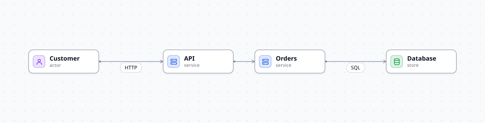
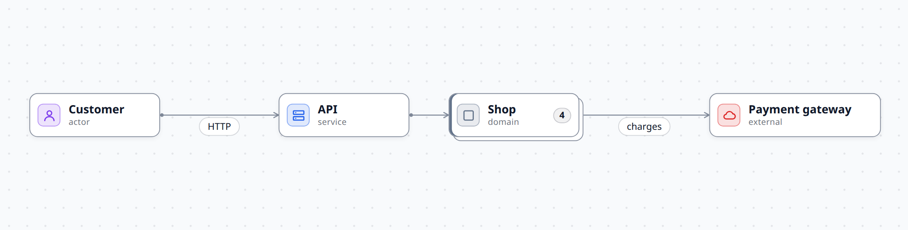
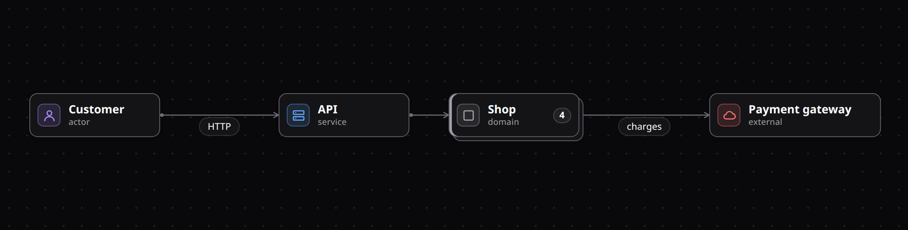
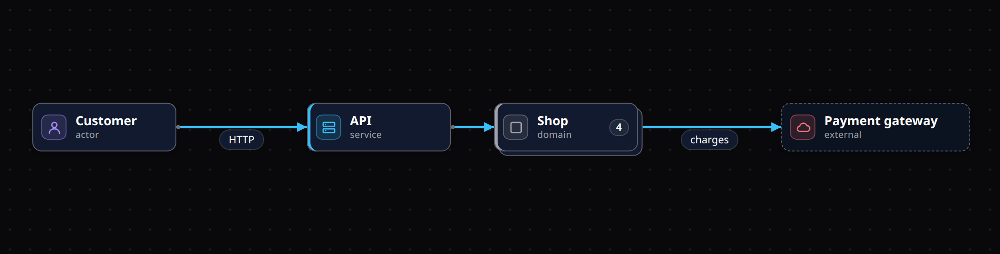
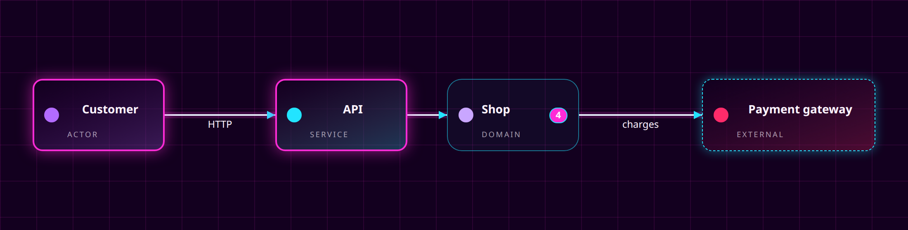
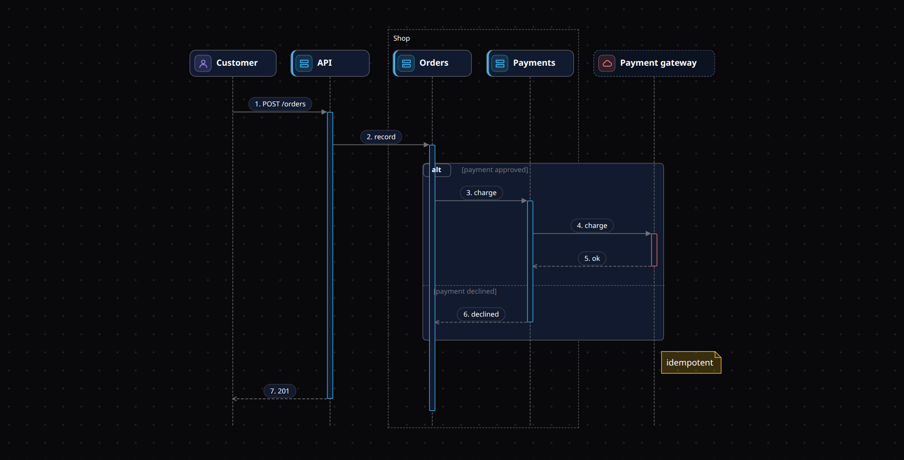
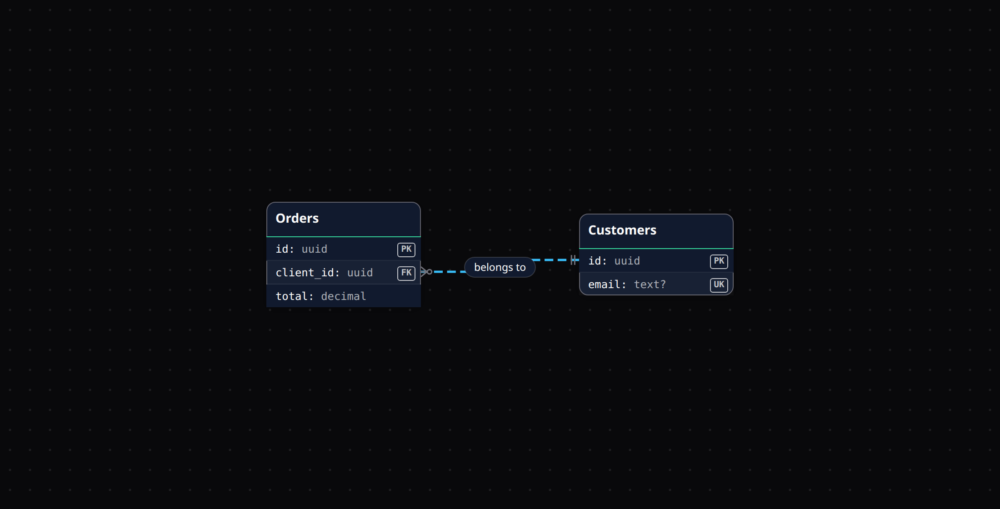

[Read in English](../guide/tutorial.md)

# Tutorial: un diagrama pequeno y su personalizacion

Vas a describir una tienda en linea con cuatro piezas, verla en el visor y cambiar su estetica en tres pasos. Cada paso es un Workspace completo en [`examples/tutorial/`](../../examples/tutorial/), asi que puedes abrirlo y comparar con lo que escribes. Una prueba del repo valida los seis, para que el tutorial no se desactualice.

Necesitas haber hecho el [inicio rapido](quick-start.md) (`pnpm install && pnpm build`); `dg` es el alias del CLI que se define alli.

Crea una carpeta vacia, por ejemplo `mi-tienda/`, y trabaja ahi. Para ver cada cambio:

```
dg dev --workspace my-shop
```

## Paso 1: lo minimo

Crea `mi-tienda/shop.dg`:

```dg
specification {
  node actor    { description "Who uses the system"  icon user     color purple }
  node service  { description "Logic piece"          icon server   color blue }
  node store    { description "Data that persists"   icon database color green }
}

model {
  actor client "Customer" "Places orders"

  service api "API" "Entry point"
  service orders "Orders" "Records orders"
  store db "Database" "Stores the orders"

  client -> api "HTTP"
  api -> orders
  orders -> db "SQL"
}

view main {
  type architecture
  include **
}
```

Tres ideas:

- `specification` declara los **Tipos de nodo**. Usar un Tipo que no declaraste es un error de `validate`. Cada Tipo trae un icono y un color de la Paleta.
- En `model`, un Nodo se escribe `tipo id "Titulo" "descripcion"`. Las Aristas se escriben `origen -> destino "etiqueta"` y conectan ids.
- Una `view` solo **elige** Nodos del Modelo (`include **` los toma todos); nunca crea entidades nuevas.

Sin `theme`, la Vista usa el Tema incorporado `neutral`:



Verifica con `dg validate --workspace mi-tienda`: debe decir `0 errors, 0 warnings`. Este paso esta en [`examples/tutorial/step-1`](../../examples/tutorial/step-1).

## Paso 2: Grupos, Atributos y una segunda Vista

Un **Grupo** es un Nodo que contiene otros Nodos; se anidan sin limite. Los **Atributos** (`attrs`) son campos de un Nodo y tambien pueden ser extremos de una Arista (`shop.db#total`). Cambia el Modelo asi (el resto del archivo no cambia, salvo los tipos nuevos `queue`, `external` y `domain` en `specification`):

```
model {
  actor client "Customer" "Places orders"
  service api "API" "Entry point"

  domain shop "Shop" {
    service orders "Orders" "Records orders"
    service payments "Payments" "Charges the orders"
    queue events "Events"
    store db "Database" {
      attrs {
        id: uuid
        total: decimal "in cents"
      }
    }
  }

  external stripe "Payment gateway"

  client -> api "HTTP"
  api -> shop.orders
  shop.orders -> shop.events "order created"
  shop.events -> shop.payments
  shop.payments -> stripe "charges"
  shop.orders -> shop.db
}
```

Los hijos se referencian por id cualificado (`shop.orders`). Ahora la Vista principal colapsa el Grupo y enlaza a una segunda Vista con su detalle (drill-down):

```
view main {
  type architecture
  include **
  collapsed shop
  link shop -> shop-detail
}

view shop-detail {
  type architecture
  include shop.**, api, stripe
}
```

`collapsed shop` muestra el Grupo como un solo Nodo con su contador de hijos y eleva las Aristas de sus hijos a su borde. En el visor, el enlace te lleva a `shop-detail`. Para abrirlo en la misma Vista usa `expanded shop`.



Completo en [`examples/tutorial/step-2`](../../examples/tutorial/step-2).

## Paso 3: cambiar de Tema

Hay tres Temas incorporados: `neutral` (claro, el defecto), `neutral-dark` y `high-contrast`. Se elige en la Vista:

```
view main {
  theme neutral-dark
  type architecture
  include **
  collapsed shop
  link shop -> shop-detail
}
```

Esa es toda la diferencia: el Modelo y la Vista no cambian, solo `theme`.



Completo en [`examples/tutorial/step-3`](../../examples/tutorial/step-3).

## Paso 4: tu propio Tema

Un Tema es texto, igual que el Modelo. La forma mas corta de hacer uno propio es **extender** uno existente y cambiar solo lo que quieras. Crea `mi-tienda/theme.dg`:

```
theme shop extends neutral-dark {
  palette { blue "#38bdf8"  green "#34d399"  fondo "#0b1220"  papel "#111a2e" }

  node {
    type service { use bar }
    type external { use dashed }
  }

  edge {
    layer linea line { color blue  width 2.4  corner round  radius 12 }
    end arrow { size 11  color blue }
  }
}

part bar { layer acento shadow after borde { color COLOR  x 4  y 0  inset 1 } }
part dashed { layer relleno { color fondo }  layer borde dashed { color marco } }
```

Y en las dos Vistas cambia `theme neutral-dark` por `theme shop`. Que paso:

- `palette` pisa algunos colores del padre. En un Tema todo color es un **nombre de Paleta**; los valores hex solo viven aqui.
- `node { type service { ... } }` es un **parche por Tipo**: aplica solo a los Nodos de ese Tipo. `use bar` incluye una **Parte** (`part`), un parche reutilizable. `COLOR` dentro de una Parte toma el color del Tipo del Nodo que la usa: la barra de `service` es azul y la de otro Tipo tendria el suyo.
- `layer <nombre> <primitiva> { ... }` define, cambia o agrega una **Capa**. `layer borde dashed` cambia la Capa `borde` del padre a una Primitiva discontinua; `layer acento shadow after borde` agrega una Capa nueva justo despues de `borde`. (Las Capas y nombres de Paleta incorporados, como `borde`, `relleno`, `fondo` y `marco`, conservan su nombre en espanol.)
- `edge { ... }` cambia las Aristas: trazo grueso, esquinas redondeadas y punta de flecha.



Completo en [`examples/tutorial/step-4`](../../examples/tutorial/step-4). Si te equivocas en una Primitiva o una propiedad, `validate` dice cual y sugiere la correcta.

## Paso 5 (opcional): un Tema desde cero

Sin `extends`, un Tema declara todo lo que quiere ver: la Paleta, las fuentes, el fondo de pagina (`page`), las Capas de `node`, `group` y `edge`, y el reparto de los Slots (icono, titulo, insignia...). Ademas de Capas estaticas puede llevar:

- **Estados** (`state hover { ... }`) que cambian la pintura al pasar el raton, seleccionar o estar en una ruta.
- **Movimiento** (`motion aura 2s`) colgado de una Capa, y efectos de entrada (`enter fade 300ms`).

El Tema `neon` de [`examples/tutorial/step-5/neon.dg`](../../examples/tutorial/step-5/neon.dg) usa todo eso en unas 40 lineas:



Pasa el raton sobre un Nodo para ver el glow cambiar y compara con el glow pulsante del Tema `synthwave` en la [galeria](../gallery.md).

## Paso 6 (opcional): secuencia y ER

El mismo Modelo se dibuja de otras formas cambiando el `type` de la Vista. [`examples/tutorial/step-6`](../../examples/tutorial/step-6) suma a la tienda una **Interaccion** (un escenario ordenado entre Nodos, con un Fragmento `alt` y una Nota) y dos tablas con claves:

```dg
specification {
  node actor    { icon user     color purple }
  node service  { icon server   color blue }
  node store    { icon database color green }
}

model {
  actor client "Customer"
  service api "API"
  service orders "Orders"
  service payments "Payments"

  store customers "Customers" {
    id: uuid pk
    email: text? uk
  }
  store orders-table "Orders" {
    id: uuid pk
    client_id: uuid fk
    total: decimal "in cents"
  }
  orders-table#client_id "0..*" -> "1" customers#id "belongs to"

  interaction purchase "Purchase" {
    client -> api "POST /orders"
    api -> orders "record"
    alt "payment approved" {
      orders -> payments "charge"
    } else "payment declined" {
      reply payments -> orders "declined"
    }
    note right of payments "idempotent"
    reply api -> client "201"
  }
}

view purchase-sequence { type sequence  interaction purchase  autonumber }
view tables { type er  include customers, orders-table }
```






Las Lifelines son los Nodos del Modelo; la Vista `er` dibuja cada Nodo hoja como tabla y las Aristas con cardinalidad (`"0..*" -> "1"`) como claves foraneas. El Tema `shop` se aplica sin cambios: lo que no declara se deriva de `node` y `edge`. Mira todos los Temas de ejemplo en secuencia y ER en la galeria (`examples/themes/gallery`).

## Siguiente

- [Personalizar con Temas](themes.md): el modelo de Capas, estados y movimiento en detalle.
- [Referencia del DSL](dsl-reference.md): Pins, Pasos para revelar un diagrama, `source`.
- Mira como esta escrito el mapa del repo en [`examples/rinthel-arch/`](../../examples/rinthel-arch/).
