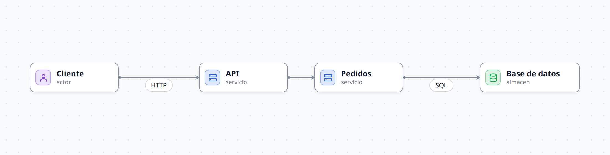
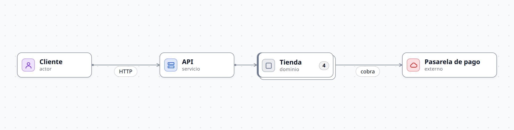
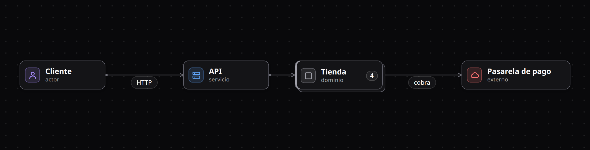
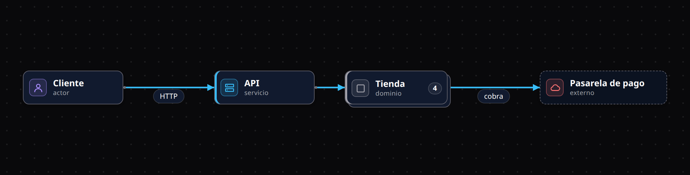
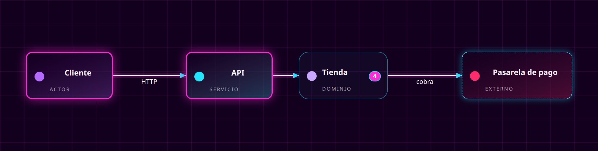

# Tutorial: un diagrama pequeno y su personalizacion

Vas a describir una tienda en linea con cuatro piezas, verla en el visor y cambiar su estetica en tres pasos. Cada paso es un Workspace completo en [`examples/tutorial/`](../../examples/tutorial/), asi que puedes abrirlo y comparar con lo que escribes. Una prueba del repo valida los cinco, para que el tutorial no se desactualice.

Necesitas haber hecho el [inicio rapido](inicio-rapido.md) (`pnpm install && pnpm build`); `dg` es el alias del CLI que se define alli.

Crea una carpeta vacia, por ejemplo `mi-tienda/`, y trabaja ahi. Para ver cada cambio:

```
dg dev --workspace mi-tienda
```

## Paso 1: lo minimo

Crea `mi-tienda/tienda.dg`:

```
specification {
  node actor    { description "Quien usa el sistema"  icon user     color purple }
  node servicio { description "Pieza de logica"       icon server   color blue }
  node almacen  { description "Datos que persisten"   icon database color green }
}

model {
  actor cliente "Cliente" "Hace pedidos"

  servicio api "API" "Punto de entrada"
  servicio pedidos "Pedidos" "Registra pedidos"
  almacen db "Base de datos" "Guarda los pedidos"

  cliente -> api "HTTP"
  api -> pedidos
  pedidos -> db "SQL"
}

view principal {
  type architecture
  include **
}
```

Tres ideas:

- `specification` declara los **Tipos de nodo**. Usar un Tipo que no declaraste es un error de `validate`. Cada Tipo trae un icono y un color de la Paleta.
- En `model`, un Nodo se escribe `tipo id "Titulo" "descripcion"`. Las Aristas se escriben `origen -> destino "etiqueta"` y conectan ids.
- Una `view` solo **elige** Nodos del Modelo (`include **` los toma todos); nunca crea entidades nuevas.

Sin `theme`, la Vista usa el Tema incorporado `neutral`:



Verifica con `dg validate --workspace mi-tienda`: debe decir `0 errores, 0 avisos`. Este paso esta en [`examples/tutorial/paso-1`](../../examples/tutorial/paso-1).

## Paso 2: Grupos, Atributos y una segunda Vista

Un **Grupo** es un Nodo que contiene otros Nodos; se anidan sin limite. Los **Atributos** (`attrs`) son campos de un Nodo y tambien pueden ser extremos de una Arista (`tienda.db#total`). Cambia el Modelo asi (el resto del archivo no cambia, salvo los tipos nuevos `cola`, `externo` y `dominio` en `specification`):

```
model {
  actor cliente "Cliente" "Hace pedidos"
  servicio api "API" "Punto de entrada"

  dominio tienda "Tienda" {
    servicio pedidos "Pedidos" "Registra pedidos"
    servicio pagos "Pagos" "Cobra los pedidos"
    cola eventos "Eventos"
    almacen db "Base de datos" {
      attrs {
        id: uuid
        total: decimal "en centavos"
      }
    }
  }

  externo stripe "Pasarela de pago"

  cliente -> api "HTTP"
  api -> tienda.pedidos
  tienda.pedidos -> tienda.eventos "pedido creado"
  tienda.eventos -> tienda.pagos
  tienda.pagos -> stripe "cobra"
  tienda.pedidos -> tienda.db
}
```

Los hijos se referencian por id cualificado (`tienda.pedidos`). Ahora la Vista principal colapsa el Grupo y enlaza a una segunda Vista con su detalle (drill-down):

```
view principal {
  type architecture
  include **
  collapsed tienda
  link tienda -> tienda-detalle
}

view tienda-detalle {
  type architecture
  include tienda.**, api, stripe
}
```

`collapsed tienda` muestra el Grupo como un solo Nodo con su contador de hijos y eleva las Aristas de sus hijos a su borde. En el visor, el enlace te lleva a `tienda-detalle`. Para abrirlo en la misma Vista usa `expanded tienda`.



Completo en [`examples/tutorial/paso-2`](../../examples/tutorial/paso-2).

## Paso 3: cambiar de Tema

Hay tres Temas incorporados: `neutral` (claro, el defecto), `neutral-dark` y `alto-contraste`. Se elige en la Vista:

```
view principal {
  theme neutral-dark
  type architecture
  include **
  collapsed tienda
  link tienda -> tienda-detalle
}
```

Esa es toda la diferencia: el Modelo y la Vista no cambian, solo `theme`.



Completo en [`examples/tutorial/paso-3`](../../examples/tutorial/paso-3).

## Paso 4: tu propio Tema

Un Tema es texto, igual que el Modelo. La forma mas corta de hacer uno propio es **extender** uno existente y cambiar solo lo que quieras. Crea `mi-tienda/tema.dg`:

```
theme tienda extends neutral-dark {
  palette { blue "#38bdf8"  green "#34d399"  fondo "#0b1220"  papel "#111a2e" }

  node {
    type servicio { use barra }
    type externo { use discontinuo }
  }

  edge {
    layer linea line { color blue  width 2.4  corner round  radius 12 }
    end arrow { size 11  color blue }
  }
}

part barra { layer acento shadow after borde { color COLOR  x 4  y 0  inset 1 } }
part discontinuo { layer relleno { color fondo }  layer borde dashed { color marco } }
```

Y en las dos Vistas cambia `theme neutral-dark` por `theme tienda`. Que paso:

- `palette` pisa algunos colores del padre. En un Tema todo color es un **nombre de Paleta**; los valores hex solo viven aqui.
- `node { type servicio { ... } }` es un **parche por Tipo**: aplica solo a los Nodos de ese Tipo. `use barra` incluye una **Parte** (`part`), un parche reutilizable. `COLOR` dentro de una Parte toma el color del Tipo del Nodo que la usa: la barra de `servicio` es azul y la de otro Tipo tendria el suyo.
- `layer <nombre> <primitiva> { ... }` define, cambia o agrega una **Capa**. `layer borde dashed` cambia la Capa `borde` del padre a una Primitiva discontinua; `layer acento shadow after borde` agrega una Capa nueva justo despues de `borde`.
- `edge { ... }` cambia las Aristas: trazo grueso, esquinas redondeadas y punta de flecha.



Completo en [`examples/tutorial/paso-4`](../../examples/tutorial/paso-4). Si te equivocas en una Primitiva o una propiedad, `validate` dice cual y sugiere la correcta.

## Paso 5 (opcional): un Tema desde cero

Sin `extends`, un Tema declara todo lo que quiere ver: la Paleta, las fuentes, el fondo de pagina (`page`), las Capas de `node`, `group` y `edge`, y el reparto de los Slots (icono, titulo, insignia...). Ademas de Capas estaticas puede llevar:

- **Estados** (`state hover { ... }`) que cambian la pintura al pasar el raton, seleccionar o estar en una ruta.
- **Movimiento** (`motion aura 2s`) colgado de una Capa, y efectos de entrada (`enter fundido 300ms`).

El Tema `neon` de [`examples/tutorial/paso-5/neon.dg`](../../examples/tutorial/paso-5/neon.dg) usa todo eso en unas 40 lineas:



Pasa el raton sobre un Nodo para ver el glow cambiar y compara con el glow pulsante del Tema `synthwave` en el [mapa del repo](../../README.md#galeria).

## Siguiente

- [Personalizar con Temas](personalizar-temas.md): el modelo de Capas, estados y movimiento en detalle.
- [Referencia del DSL](referencia-dsl.md): Pins, Pasos para revelar un diagrama, `source`.
- Mira como esta escrito el mapa del repo en [`examples/rinthel-arch/`](../../examples/rinthel-arch/).
