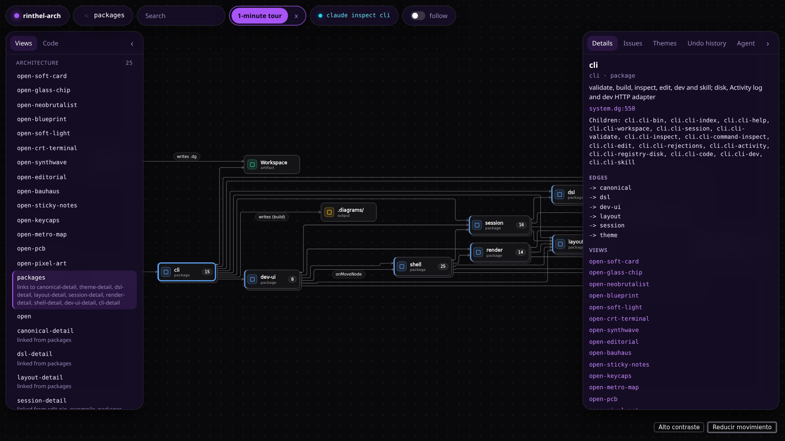
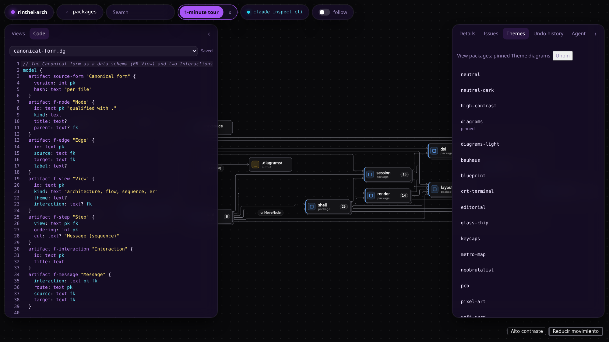
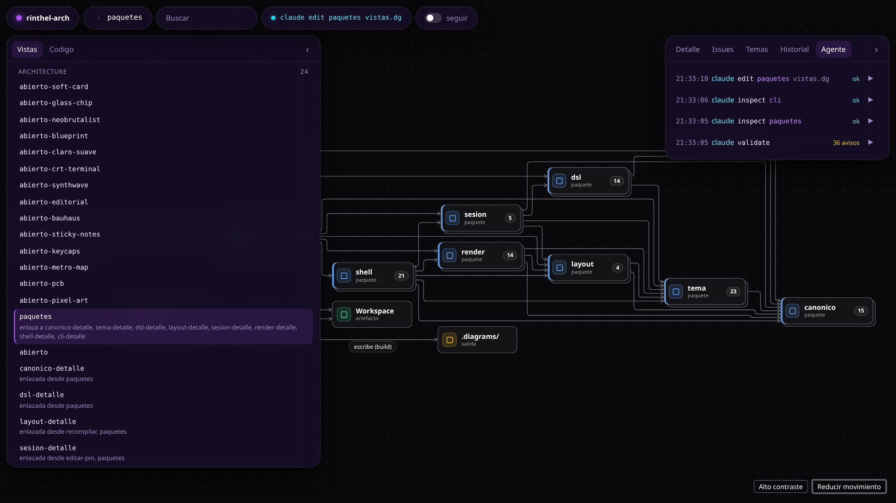
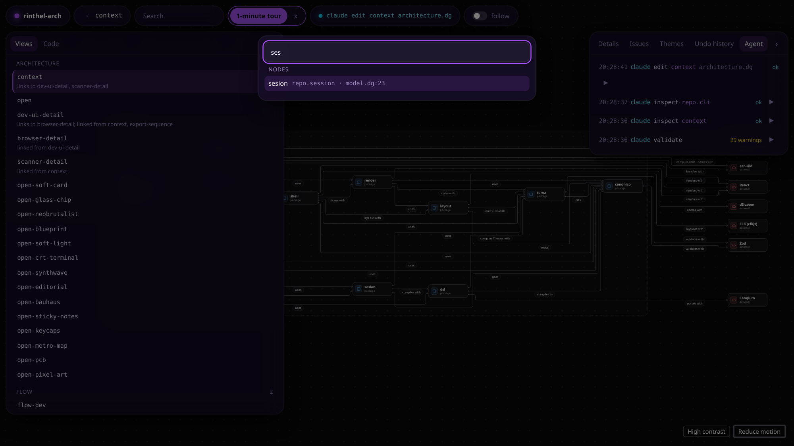

# UI de dev

`dg dev --workspace <ruta>` abre en `http://127.0.0.1:4173/` una UI para mirar, editar y seguir un Workspace mientras un agente (o tu editor) lo cambia. Arranque y opciones del comando: [CLI, `dev`](cli.md#dev-visor-en-vivo).



El lienzo ocupa toda la pagina. Arriba va la barra (Vista actual con su ruta, Buscar, ultima linea del agente y "seguir"); a los lados, dos paneles flotantes. Cada panel se oculta con su boton o con Ctrl/Cmd+B (izquierdo) y Ctrl/Cmd+J (derecho), y se redimensiona arrastrando su borde. La Vista activa queda en la URL como `#vista=<id>`, asi que se puede compartir o volver con Atras.

## Panel izquierdo

- **Vistas**: el indice agrupado por Tipo de diagrama, con las Vistas que enlazan o son enlazadas. Clic o flechas cambian de Vista. Un punto marca las Vistas que cambiaron por fuera y aun no visitaste.
- **Codigo**: editor del DSL; se abre tambien con doble clic en un Nodo (en su bloque) y abre a la vez Issues en la isla derecha. Guarda solo (unos 400 ms despues de dejar de teclear, al perder el foco o con Ctrl/Cmd+S), aunque el texto no compile: el lienzo conserva el ultimo dibujo bueno y los arrastres se deshabilitan con el motivo a la vista. Issues en linea con su `fix`, completado de palabras clave e ids, F12 a la definicion; Esc vuelve a Vistas. Si otro programa escribe el mismo archivo, el editor mezcla su texto con el tuyo (gana el disco donde chocan), marca lo que llego de fuera y ofrece recuperar lo que se perdio. Los archivos de `--theme-path` se abren en solo lectura.



## Panel derecho

- **Detalle**: el Nodo seleccionado en el lienzo, como lo da `inspect nodo`: descripcion, `archivo:linea`, hijos, Aristas y las Vistas que lo muestran (clic para ir).
- **Issues**: los issues del ultimo estado con filtro por texto y severidad. Cada uno salta a su `archivo:linea`; los que traen `fix` lo aplican con un boton y "Aplicar N fix" aplica de una vez los visibles.
- **Temas**: la galeria. Clic, o flechas y Enter, eligen un Tema; elegirlo lo previsualiza en la Vista activa sin escribir (con su cadena `extends`, Paleta y Capas); "Fijar" escribe `theme` en la Vista y "Quitar" lo borra (la Intencion `fijar-tema` de `edit`).
- **Historial**: cada guardado, Gesto o `fix` es una entrada, la mas reciente arriba y al final Inicio. Clic en una entrada lleva el Workspace a ese punto (Ctrl/Cmd+Z y Ctrl/Cmd+Shift+Z mueven de a una). Una entrada cuyo archivo cambio fuera de la UI queda deshabilitada con el motivo: restaurarla pisaria ese cambio.
- **Agente**: el feed del Registro de actividad (ver abajo).

## Seguir a un agente

Los comandos `validate`, `build`, `inspect` y `edit` anotan cada ejecucion en `<ruta>/.diagrams/actividad.jsonl`; `dev` la lee aparte del Workspace. Para que el feed diga quien fue, el agente exporta un nombre:

```
export DIAGRAMS_AGENTE=claude          # aparece en cada linea del feed
dg validate --workspace <ruta> --json
```

`DIAGRAMS_ACTIVIDAD=0` apaga el registro. Detalle del formato y la rotacion: [Registro de actividad](cli.md#registro-de-actividad).



- El panel **Agente** muestra los ultimos 50 Eventos al abrir y los nuevos en vivo: hora, agente, comando, objetivo clicable (Vista, Nodo, archivo) y resultado; "Ver args" despliega el argv. La pildora de la barra resume la ultima linea y cuenta las que no viste.
- Todo lo que cambia por fuera de la pagina (el CLI, un agente que edita el `.dg` a mano u otro editor) se resalta unos 5 s en el lienzo, marca en el indice las otras Vistas que lo muestran y en la galeria los Temas cambiados; lo quitado se lista en el panel Agente hasta el siguiente cambio externo. Lo que escribe la propia UI no se resalta.
- Con **seguir** activo, la UI salta a la Vista o al Nodo que nombra cada Evento; un cambio sin Evento no mueve la Vista: solo se resalta y marca en el indice las Vistas que toca.

## Buscador y atajos

Ctrl/Cmd+K abre el Buscador: Vistas, Nodos (con su `archivo:linea`), comandos y un `archivo:linea` escrito tal cual, que abre Codigo en esa linea.



| Atajo | Accion |
| --- | --- |
| Ctrl/Cmd+K | Buscador |
| `?` o Ctrl/Cmd+/ | Lista de atajos |
| E | Abrir Codigo en la Vista o Nodo actual |
| Ctrl/Cmd+B, Ctrl/Cmd+J | Ocultar o mostrar el panel izquierdo, derecho |
| Ctrl/Cmd+Z, Ctrl/Cmd+Shift+Z (Ctrl+Y fuera de macOS) | Deshacer, rehacer en el Historial (dentro del editor, el texto) |
| Ctrl/Cmd+S | Guardar el texto ya |
| Esc | Salir del editor |
