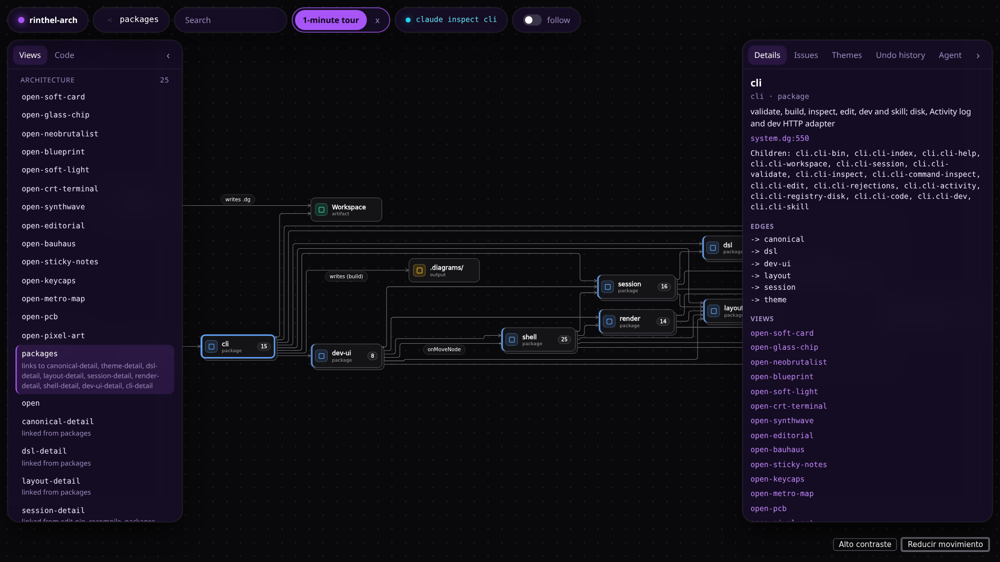
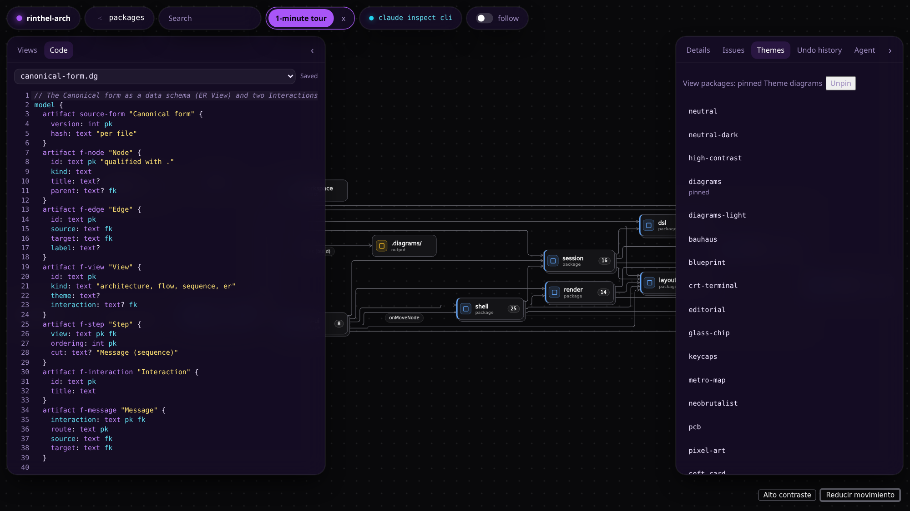
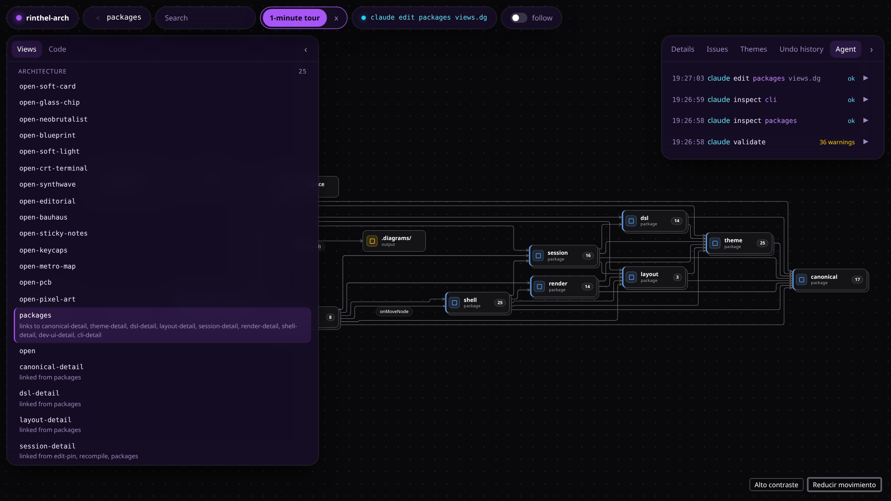
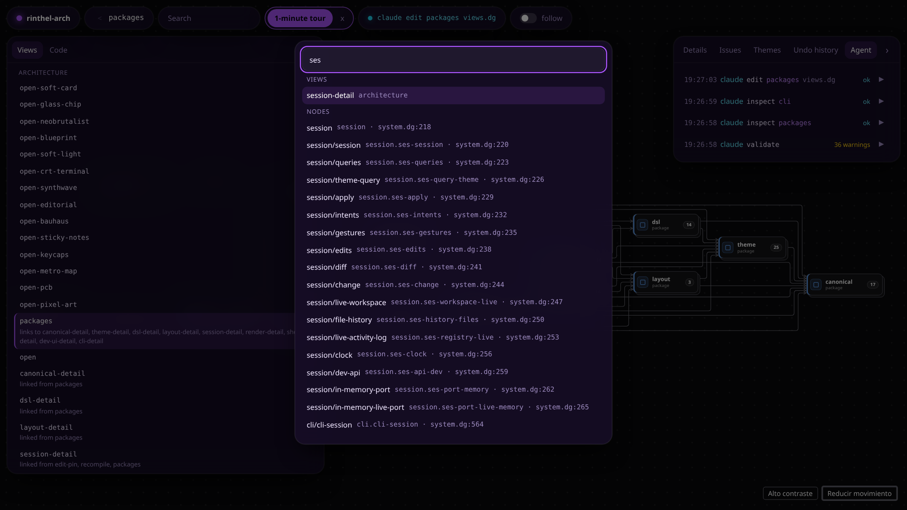

[Leer en espanol](../guia/dev-ui.md)

# Dev UI

`dg dev --workspace <path>` opens at `http://127.0.0.1:4173/` a UI to look at, edit and follow a Workspace while an agent (or your editor) changes it. Command startup and options: [CLI, `dev`](cli.md#dev-live-viewer).



The canvas takes the whole page. At the top is the bar (current View with its path, Search, the agent's last line and "follow"); on the sides, two floating panels. Each panel is hidden with its button or with Ctrl/Cmd+B (left) and Ctrl/Cmd+J (right); when hidden, it leaves a tab on the edge that shows it again. It is resized by dragging its edge or corner (the width and height handles also respond to the arrow keys; double click on the height one returns to the content height). The active View stays in the URL as `#vista=<id>`, so it can be shared or returned to with Back. Over the canvas are the Step controls (if the View has them), the "High contrast" button (draws with the `high-contrast` Theme without writing anything) and "Reduce motion", and the legend when there are kinds that are only told apart by color.

## Left panel

- **Views**: the index grouped by Diagram type, with the Views that link or are linked. Click or arrows (Home and End go to the first and last) change View. A dot marks the Views that changed from outside and that you have not yet visited.
- **Code**: the DSL editor; it also opens with a double click on a Node (at its block) and opens Issues on the right island at the same time. It saves by itself (about 400 ms after you stop typing, on losing focus or with Ctrl/Cmd+S), even if the text does not compile: the canvas keeps the last good drawing and drags are disabled with the reason in view. Inline Issues with their `fix`, completion of keywords and ids, F12 to go to a definition; Esc returns to Views. If another program writes the same file, the editor merges its text with yours (the disk wins where they collide), marks what came from outside and offers to recover what was lost. Files from `--theme-path` open read-only.



## Right panel

- **Details**: the Node selected on the canvas, as `inspect node` gives it: description, `file:line`, parent, children, Attributes, Edges and the Views that show it (click to go).
- **Issues**: the issues of the latest state with a filter by text and severity. Each one jumps to its `file:line`; those with a `fix` apply it with a button and "Apply N fix" applies the visible ones at once.
- **Themes**: the gallery. Click, or arrows and Enter, choose a Theme; choosing it previews it on the active View without writing (with its `extends` chain, Palette and Layers) until "Stop previewing"; "Pin" writes `theme` in the View and "Unpin" removes it (the `set-theme` Intent of `edit`).
- **Undo history**: the file History; each save, Gesture, `fix` or pinned Theme is an entry, the most recent on top and Start at the end. Clicking an entry takes the Workspace to that point (Ctrl/Cmd+Z and Ctrl/Cmd+Shift+Z move one at a time). An entry whose file changed outside the UI is disabled with the reason: restoring it would overwrite that change.
- **Agent**: the Activity log feed (see below).

## Follow an agent

The `validate`, `build`, `inspect` and `edit` commands note each run in `<path>/.diagrams/actividad.jsonl`; `dev` reads it separately from the Workspace. For the feed to say who it was, the agent exports a name:

```
export DIAGRAMS_AGENTE=claude          # appears on each line of the feed
dg validate --workspace <path> --json
```

`DIAGRAMS_ACTIVIDAD=0` turns the log off. Format and rotation details: [Activity log](cli.md#activity-log).



- The **Agent** panel shows the last 50 events on opening and the new ones live: time, agent, command, clickable target (View, Node, file) and result; "Show args" expands the argv. The bar pill summarizes the last line and counts the ones you have not seen.
- Everything that changes outside the page (the CLI, an agent that edits the `.dg` by hand or another editor) is highlighted for about 5 s on the canvas, marks in the index the other Views that show it and in the gallery the changed Themes; what was removed is listed in the Agent panel until the next external change. What the UI itself writes is not highlighted.
- With **follow** on, the UI jumps to the View or Node that each event names; a change without an event does not move the View: it only highlights and marks in the index the Views it touches.

## Finder and shortcuts

Ctrl/Cmd+K opens the Finder: Views, Nodes (with their `file:line`), commands and a `file:line` typed as is, which opens Code at that line.



| Shortcut | Action |
| --- | --- |
| Ctrl/Cmd+K | Finder |
| `?` or Ctrl/Cmd+/ | List of shortcuts |
| E | Open Code at the current View or Node |
| Ctrl/Cmd+B, Ctrl/Cmd+J | Hide or show the left, right panel |
| Ctrl/Cmd+Z, Ctrl/Cmd+Shift+Z (Ctrl+Y outside macOS) | Undo, redo in the History (inside the editor, the text) |
| Ctrl/Cmd+S | Save the text now |
| Esc | Leave the editor |

The first visit shows in the bar the "1-minute tour" pill: a walk of coachmarks through the canvas, Views, Drill-down (if the Workspace has a `link`), Steps, Themes, Code and Agent, with the data of the open Workspace. Using it or closing it with its "x" does not bring it back (it is remembered in the browser); the tour stays available by hand with "View tour" in the Finder or in the `?` help.

## Read-only export

`dg export --workspace <path> --out <file>.html` writes this same UI as a single HTML file to send to someone who does not have the tool ([CLI](cli.md#export-a-self-contained-html-to-send-to-anyone)). What remains is the Views panel, the Theme gallery (preview, without "Pin"), the canvas with Steps, `link` and collapse, and the Finder with Views and commands; Code, Details, Issues, Undo history and Agent are not there, nor are the shortcuts that write. The bar shows "Read-only". The tour is there too, with an "In your repo" stop (`npx rinthel-arch scan` and then `dev`) instead of Code and Agent.
