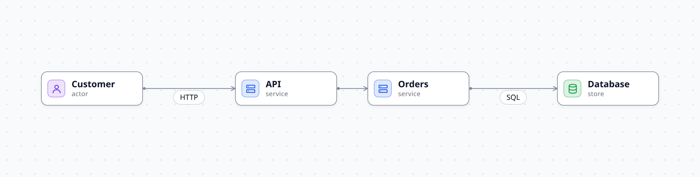
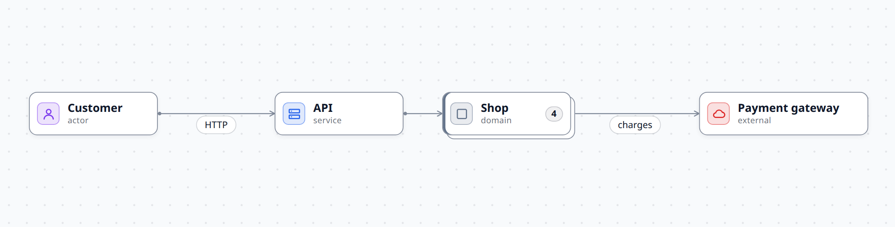
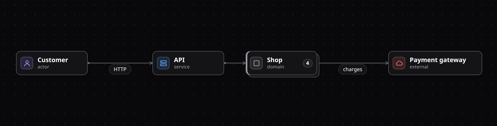
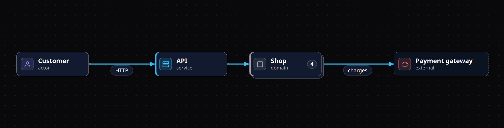
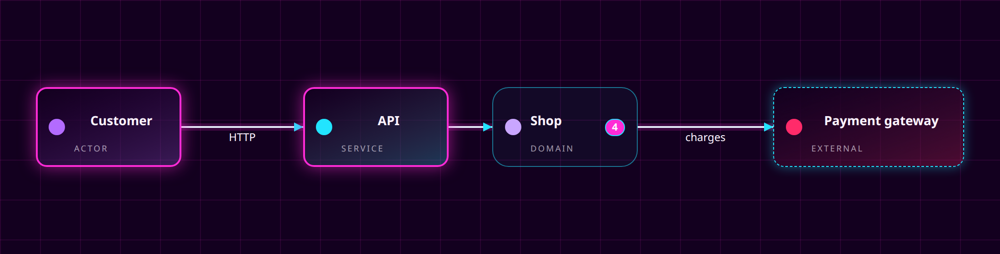
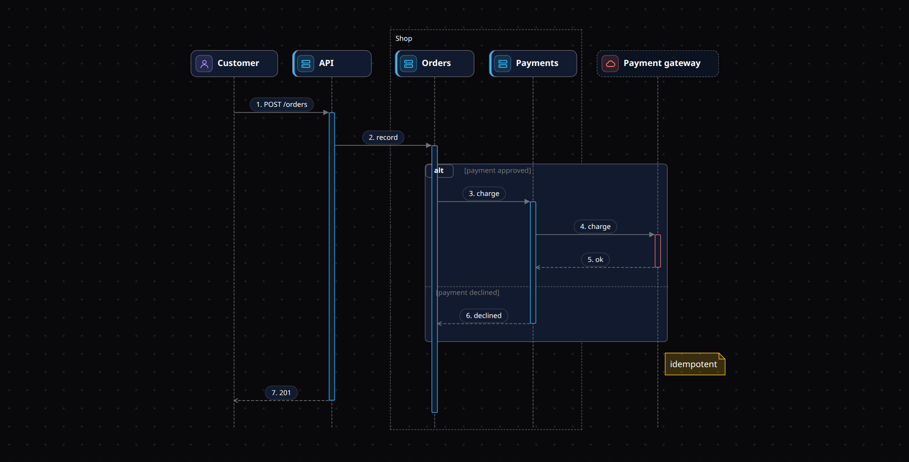
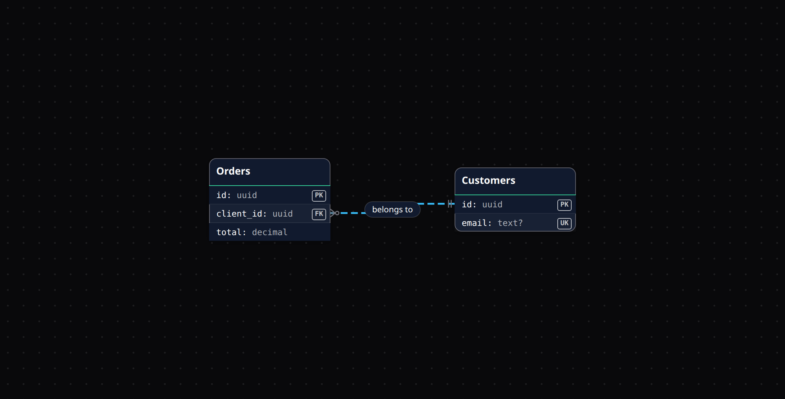

[Leer en espanol](../guia/tutorial.md)

# Tutorial: a small diagram and its customization

You will describe an online shop with four pieces, see it in the viewer and change its aesthetic in three steps. Each step is a complete Workspace in [`examples/tutorial/`](../../examples/tutorial/), so you can open it and compare with what you write. A test in the repo validates all six, so the tutorial does not go stale.

You need to have done the [quick start](quick-start.md) (`pnpm install && pnpm build`); `dg` is the CLI alias defined there.

Create an empty folder, for example `my-shop/`, and work there. To see each change:

```
dg dev --workspace my-shop
```

## Step 1: the minimum

Create `my-shop/shop.dg`:

```dg
specification {
  node actor    { description "Who uses the system"  icon user     color purple }
  node service  { description "Logic piece"          icon server   color blue }
  node store    { description "Data that persists"   icon database color green }
}

model {
  actor client "Customer" "Places orders"

  service api "API" "Entry point"
  service orders "Orders" "Records orders"
  store db "Database" "Stores the orders"

  client -> api "HTTP"
  api -> orders
  orders -> db "SQL"
}

view main {
  type architecture
  include **
}
```

Three ideas:

- `specification` declares the **Node kinds**. Using a kind you did not declare is a `validate` error. Each kind brings an icon and a color from the Palette.
- In `model`, a Node is written `kind id "Title" "description"`. Edges are written `source -> target "label"` and connect ids.
- A `view` only **chooses** Nodes from the Model (`include **` takes them all); it never creates new entities.

Without `theme`, the View uses the built-in `neutral` Theme:



Check with `dg validate --workspace my-shop`: it should say `0 errors, 0 warnings`. This step is in [`examples/tutorial/step-1`](../../examples/tutorial/step-1).

## Step 2: Groups, Attributes and a second View

A **Group** is a Node that contains other Nodes; they nest without limit. **Attributes** (`attrs`) are the fields of a Node and can also be the ends of an Edge (`shop.db#total`). Change the Model like this (the rest of the file stays the same, except for the new kinds `queue`, `external` and `domain` in `specification`):

```
model {
  actor client "Customer" "Places orders"
  service api "API" "Entry point"

  domain shop "Shop" {
    service orders "Orders" "Records orders"
    service payments "Payments" "Charges the orders"
    queue events "Events"
    store db "Database" {
      attrs {
        id: uuid
        total: decimal "in cents"
      }
    }
  }

  external stripe "Payment gateway"

  client -> api "HTTP"
  api -> shop.orders
  shop.orders -> shop.events "order created"
  shop.events -> shop.payments
  shop.payments -> stripe "charges"
  shop.orders -> shop.db
}
```

Children are referenced by qualified id (`shop.orders`). Now the main View collapses the Group and links to a second View with its detail (drill-down):

```
view main {
  type architecture
  include **
  collapsed shop
  link shop -> shop-detail
}

view shop-detail {
  type architecture
  include shop.**, api, stripe
}
```

`collapsed shop` shows the Group as a single Node with its child counter and lifts the Edges of its children to its border. In the viewer, the link takes you to `shop-detail`. To open it in the same View use `expanded shop`.



Complete in [`examples/tutorial/step-2`](../../examples/tutorial/step-2).

## Step 3: switch Theme

There are three built-in Themes: `neutral` (light, the default), `neutral-dark` and `high-contrast`. It is chosen in the View:

```
view main {
  theme neutral-dark
  type architecture
  include **
  collapsed shop
  link shop -> shop-detail
}
```

That is the whole difference: the Model and the View do not change, only `theme`.



Complete in [`examples/tutorial/step-3`](../../examples/tutorial/step-3).

## Step 4: your own Theme

A Theme is text, just like the Model. The shortest way to make your own is to **extend** an existing one and change only what you want. Create `my-shop/theme.dg`:

```
theme shop extends neutral-dark {
  palette { blue "#38bdf8"  green "#34d399"  fondo "#0b1220"  papel "#111a2e" }

  node {
    type service { use bar }
    type external { use dashed }
  }

  edge {
    layer linea line { color blue  width 2.4  corner round  radius 12 }
    end arrow { size 11  color blue }
  }
}

part bar { layer acento shadow after borde { color COLOR  x 4  y 0  inset 1 } }
part dashed { layer relleno { color fondo }  layer borde dashed { color marco } }
```

And in both Views change `theme neutral-dark` to `theme shop`. What happened:

- `palette` overrides some colors of the parent. In a Theme every color is a **Palette name**; hex values only live here.
- `node { type service { ... } }` is a **per-kind patch**: it applies only to Nodes of that kind. `use bar` includes a **Part** (`part`), a reusable patch. `COLOR` inside a Part takes the color of the kind of the Node that uses it: the bar of `service` is blue and another kind would get its own.
- `layer <name> <primitive> { ... }` defines, changes or adds a **Layer**. `layer borde dashed` changes the parent's `borde` Layer to a dashed Primitive; `layer acento shadow after borde` adds a new Layer right after `borde`. (The built-in Layers and Palette names, such as `borde`, `relleno`, `fondo` and `marco`, keep their Spanish names.)
- `edge { ... }` changes the Edges: thick stroke, rounded corners and an arrowhead.



Complete in [`examples/tutorial/step-4`](../../examples/tutorial/step-4). If you get a Primitive or a property wrong, `validate` says which and suggests the right one.

## Step 5 (optional): a Theme from scratch

Without `extends`, a Theme declares everything it wants to show: the Palette, the fonts, the page background (`page`), the Layers of `node`, `group` and `edge`, and the distribution of the Slots (icon, title, badge...). Besides static Layers it can carry:

- **States** (`state hover { ... }`) that change the paint on hover, selection or being on a path.
- **Motion** (`motion aura 2s`) hung from a Layer, and enter effects (`enter fade 300ms`).

The `neon` Theme in [`examples/tutorial/step-5/neon.dg`](../../examples/tutorial/step-5/neon.dg) uses all of that in about 40 lines:



Hover over a Node to see the glow change and compare with the pulsing glow of the `synthwave` Theme in the [gallery](../gallery.md).

## Step 6 (optional): sequence and ER

The same Model is drawn in other ways by changing the View `type`. [`examples/tutorial/step-6`](../../examples/tutorial/step-6) adds to the shop an **Interaction** (an ordered scenario between Nodes, with an `alt` Fragment and a Note) and two tables with keys:

```dg
specification {
  node actor    { icon user     color purple }
  node service  { icon server   color blue }
  node store    { icon database color green }
}

model {
  actor client "Customer"
  service api "API"
  service orders "Orders"
  service payments "Payments"

  store customers "Customers" {
    id: uuid pk
    email: text? uk
  }
  store orders-table "Orders" {
    id: uuid pk
    client_id: uuid fk
    total: decimal "in cents"
  }
  orders-table#client_id "0..*" -> "1" customers#id "belongs to"

  interaction purchase "Purchase" {
    client -> api "POST /orders"
    api -> orders "record"
    alt "payment approved" {
      orders -> payments "charge"
    } else "payment declined" {
      reply payments -> orders "declined"
    }
    note right of payments "idempotent"
    reply api -> client "201"
  }
}

view purchase-sequence { type sequence  interaction purchase  autonumber }
view tables { type er  include customers, orders-table }
```





The Lifelines are Model Nodes; the `er` View draws each leaf Node as a table and the Edges with cardinality (`"0..*" -> "1"`) as foreign keys. The `shop` Theme applies unchanged: whatever it does not declare is derived from `node` and `edge`. See all the example Themes in sequence and ER in the gallery (`examples/themes/gallery`).

## Next

- [Customizing with Themes](themes.md): the model of Layers, states and motion in detail.
- [DSL reference](dsl-reference.md): Pins, Steps to reveal a diagram, `source`.
- See how the repo map is written in [`examples/rinthel-arch/`](../../examples/rinthel-arch/).
